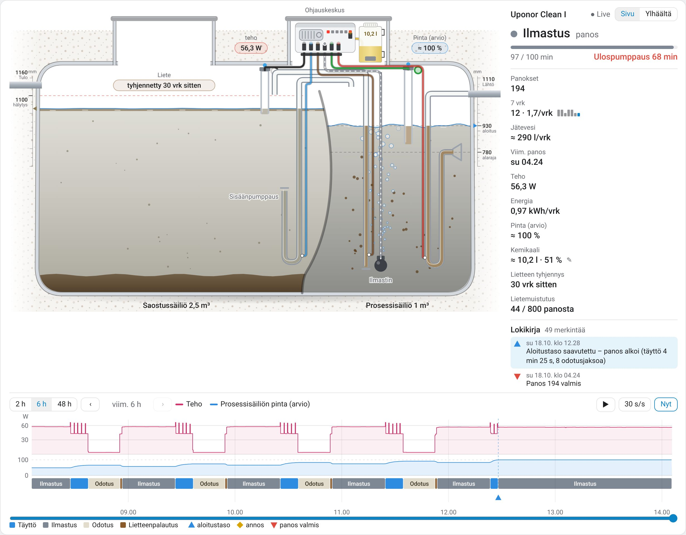
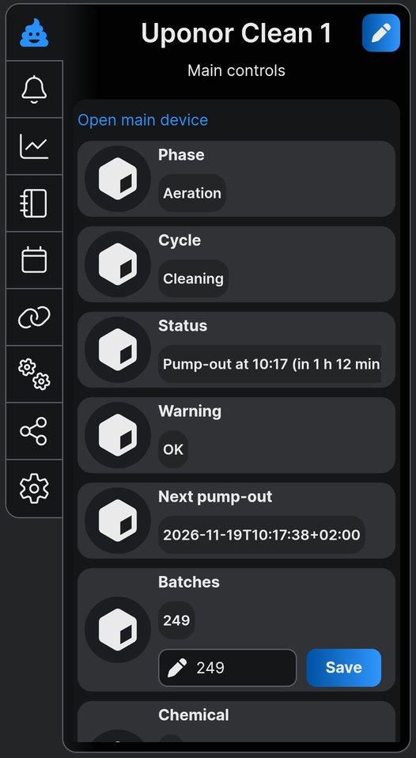
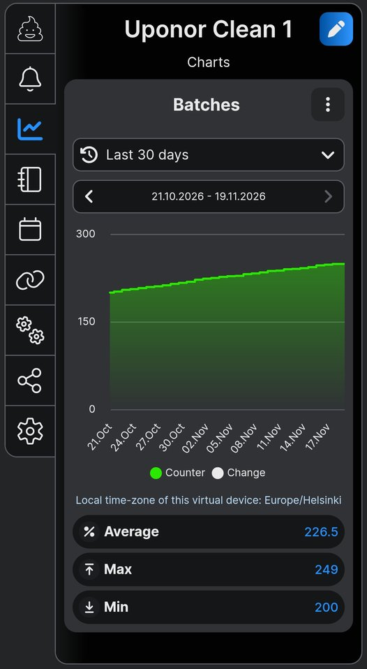

# Uponor Clean – Shelly-seuranta

[English](README.md) | **Suomi**

Shelly EM Mini Gen4 mittaa puhdistamon sähkönkulutusta. Skripti päättelee siitä ohjauskeskuksen jaksot (puhdistus, odotus, loma, testi) ja vaiheet (ilmastus, kemikaalin täyttö ja annostelu, sekoitus, laskeutus, lietteen palautus, ulospumppaus, sisäänpumppaus, odotus), laskee panokset, kemikaalin ja lietteen, arvioi seuraavan ulospumppauksen ja varoittaa poikkeamista. Home Assistant -kortti näyttää prosessin animoituna.

Home Assistantia ei tarvita: skriptin komponentit näkyvät myös Shellyn omassa käyttöliittymässä ja Shelly-sovelluksessa. Vaihe, jakso, tila, varoitus ja seuraava ulospumppaus päivittyvät reaaliajassa, ja panoslaskurin kasvu näkyy sovelluksen graafina päivittäin.

## Ohjeet

| Ohje | Sisältö | English |
| --- | --- | --- |
| [`docs/v3-asennus.md`](docs/v3-asennus.md) | Shelly-skriptin v3 asennus kuvineen, päivitys, poisto, komponentit, varoitukset, asetukset ja vianetsintä | [`v3-install.md`](docs/v3-install.md) |
| [`docs/home-assistant.md`](docs/home-assistant.md) | Home Assistant: Shelly-integraatio, entiteetit, tapahtumaentiteetti ja automaatioesimerkit | [`home-assistant.en.md`](docs/home-assistant.en.md) |
| [`docs/kortti.md`](docs/kortti.md) | Home Assistant -kortti: mitä se näyttää, asennus, kieli, asetukset, kemikaalin ja lietteen syöttö | [`ha-card/README.md`](ha-card/README.md) |
| [`docs/shelly-rajoitteet.md`](docs/shelly-rajoitteet.md) | Shellyn skriptiympäristön rajoitteet, jotka tulivat vastaan (pino, muisti, puuttuvat funktiot, komponentit, Home Assistant) | [`shelly-limits.md`](docs/shelly-limits.md) |
| [`docs/v3-testitulokset.md`](docs/v3-testitulokset.md) | v3:n testitulokset simulaattorilla, tallennetulla datalla ja laitteella | – |
| [`test/README.md`](test/README.md) | Testien ajaminen | – |

## Sisältö

| Kansio | Sisältö |
| --- | --- |
| `shelly/v3/` | Skripti v3.0.2: `uponor_clean_v3.js` (lähde) ja `uponor_clean_v3_shelly.js` (tiivistetty, ladataan Shellyyn). |
| `shelly/v2/` | Vanhat skriptit v2.4 ja v2.3 (eivät käytössä) sekä v2.4:n komponenttien varmuuskopio (`backup/`). |
| `shelly/v3/proto/` | v3-prototyypit laitetestiin ja komponenttien varmuuskopiotyökalu `uc_tools.js` (käytetty siirtymässä). Ohje: `docs/v3-prototyyppitesti.md`. |
| `shelly/tools/` | `nauhuri.ps1` (Windows-nauhuri vianetsintään: teho sekunnin välein CSV:ksi), `lataa_shellyyn.py` (lataus Shellyyn RPC:llä), `compact.py` (tiivistys), `make_v24.py` (v2.3 → v2.4 -muunnos). |
| `ha-card/` | Lovelace-kortti `uponor-clean-card.js` v1.7.2, ohje, esikatselusivu (`preview.html`) ja sen päivitystyökalu (`tools/build_preview.py`). |
| `test/` | Node-testiympäristö: ajaa oikeaa skriptitiedostoa virtuaalikellolla Shelly-jäljitelmässä, firmwaresimulaattori, skenaariot ja kortin testi. |
| `docs/` | Ohjeet, kuvat (`img/`), firmwaren pseudokoodi, v2-dokumentaatio ja v3-suunnitelman tiivistelmä. |

## Versiot

| Versio | Tila |
| --- | --- |
| Skripti v3.0.2 | Käytössä 19.11.2026 alkaen (haara `v3`). v3.0.0–3.0.1 kaatuivat ensimmäisen puhdistusjakson alussa liian syvään kutsupinoon (`docs/v3-testitulokset.md`). Ei vaadi Home Assistantia, luo komponentit itse, firmwaren mukaiset vaiheet ja jaksot, kemikaali- ja lietelaskuri, varoitukset, tapahtumat. |
| Kortti v1.7.2 | Käytössä. v3-entiteetit, v2-historia ennen v3:a, visuaalinen editori ja kielivalinta, kemikaalin ja lietteen syöttö kortilta. |
| Skripti v2.4.0 | Poistettu käytöstä 18.11.2026 ja poistettu laitteelta 19.11.2026. Ei siirtymää eikä paluuta. |
| Skripti v2.3 | Vanha versio. |

## Testattu ympäristö

Skripti ja kortti on rakennettu ja testattu yhdellä laitteistolla. Muita versioita ei ole kokeiltu.

| Osa | Versio |
| --- | --- |
| Puhdistamo | Uponor Clean I, ohjauskeskuksen kannen tarra "VERSION 2.1.2", piirilevy vuodelta 2011 |
| Shelly | Shelly EM Mini Gen4 (S4EM-001PXCEU16), firmware 2.2.0 (`20261109-150305/2.2.0-g7968dca`) |
| Home Assistant | 2026.10.2, sisäänrakennettu Shelly-integraatio |
| Kortti | Home Assistantin käyttöliittymä Chromessa (työpöytä ja kapea näkymä) |

Vanhemmilla Shellyn firmwareilla skriptiä ei ole kokeiltu. Kortin visuaalinen editori vaatii Home Assistantin, jossa on `getConfigForm` (testattu 2026.10.2). Muissa versioissa kortti toimii YAML-asetuksilla.

## Huomio ennen julkistamista

Repo on yksityinen. Ennen julkiseksi muuttamista tarkista:

- Mittausdataa (Home Assistantin historia-CSV:t) ei ole versionhallinnassa (`.gitignore`). Pidä se poissa jatkossakin.
- `ha-card/preview.html` sisältää oman laitteen mittausdatasta lasketun esimerkkijakson.
- `docs/img/` sisältää kuvakaappauksia omasta Shellystä ja Home Assistantista. Laitteen MAC-osoite on poistettu kuvista, tiedostoista ja koko historiasta (19.11.2026). Kuvakaappauksissa ei saa näkyä Shellyn käyttöliittymän alapalkkia, jossa MAC-osoite on.
- `docs/firmware/` perustuu kolmannen osapuolen firmwarevedokseen, ja `docs/kortti.md` viittaa Uponorin käsikirjaan. Varmista, että julkaiseminen on ok.
- Valitse lisenssi (esim. MIT).
