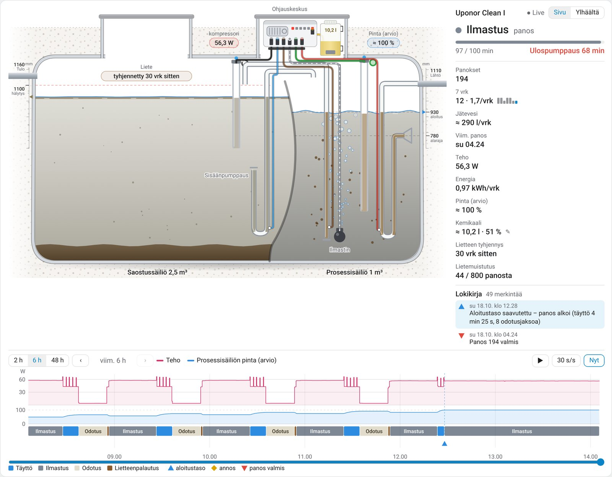

# Uponor Clean – Shelly-seuranta

*English summary: process monitoring for the Uponor Clean I small wastewater treatment plant. A Shelly EM Mini Gen4 script recognises the control unit's cycles and phases from power consumption, counts batches, chemical and sludge, and estimates the next pump-out. A Home Assistant Lovelace card visualises the plant. Version 3 follows the control unit's firmware cycle phase by phase, works without Home Assistant and creates its own virtual components. See `ha-card/README.md` for the card in English.*

Shelly EM Mini Gen4 mittaa puhdistamon sähkönkulutusta. Skripti päättelee siitä ohjauskeskuksen jaksot (puhdistus, odotus, loma, testi) ja vaiheet (ilmastus, kemikaalin täyttö ja annostelu, sekoitus, laskeutus, lietteen palautus, ulospumppaus, sisäänpumppaus, odotus), laskee panokset, kemikaalin ja lietteen, arvioi seuraavan ulospumppauksen ja varoittaa poikkeamista. Home Assistant -kortti näyttää prosessin animoituna.

## Ohjeet

| Ohje | Sisältö |
| --- | --- |
| [`docs/v3-asennus.md`](docs/v3-asennus.md) | Shelly-skriptin v3 asennus kuvineen, Home Assistant -entiteetit ja tapahtumat, päivitys, siirtymä v2.4:stä ja paluu, komponentit, varoitukset, asetukset ja vianetsintä |
| [`docs/kortti.md`](docs/kortti.md) | Home Assistant -kortti: mitä se näyttää, asennus, kieli, asetukset, kemikaalin ja lietteen syöttö |
| [`ha-card/README.md`](ha-card/README.md) | Card reference in English (all options, v2 helpers, level model) |
| [`docs/v3-testitulokset.md`](docs/v3-testitulokset.md) | v3:n testitulokset simulaattorilla, tallennetulla datalla ja laitteella |
| [`test/README.md`](test/README.md) | Testien ajaminen |

## Sisältö

| Kansio | Sisältö |
| --- | --- |
| `shelly/v3/` | Skripti v3.0.0: `uponor_clean_v3.js` (lähde) ja `uponor_clean_v3_shelly.js` (tiivistetty, ladataan Shellyyn). |
| `shelly/v2/` | Skripti v2.4 ja v2.3 sekä v2.4:n komponenttien varmuuskopio (`backup/`). Paluuta varten. |
| `shelly/v3/proto/` | v3-prototyypit laitetestiin ja komponenttien varmuuskopio- ja palautustyökalu `uc_tools.js`. Ohje: `docs/v3-prototyyppitesti.md`. |
| `shelly/tools/` | `lataa_shellyyn.py` (lataus Shellyyn RPC:llä), `compact.py` (tiivistys), `make_v24.py` (v2.3 → v2.4 -muunnos). |
| `ha-card/` | Lovelace-kortti `uponor-clean-card.js` v1.7.1, ohje, esikatselusivu (`preview.html`) ja sen päivitystyökalu (`tools/build_preview.py`). |
| `test/` | Node-testiympäristö: ajaa oikeaa skriptitiedostoa virtuaalikellolla Shelly-jäljitelmässä, firmwaresimulaattori, skenaariot ja kortin testi. |
| `docs/` | Ohjeet, kuvat (`img/`), firmwaren pseudokoodi, v2-dokumentaatio ja v3-suunnitelman tiivistelmä. |

## Versiot

| Versio | Tila |
| --- | --- |
| Skripti v3.0.0 | Käytössä 18.11.2026 alkaen (haara `v3`). Ei vaadi Home Assistantia, luo komponentit itse, firmwaren mukaiset vaiheet ja jaksot, kemikaali- ja lietelaskuri, varoitukset, tapahtumat. |
| Kortti v1.7.1 | Käytössä. v3-entiteetit, v2-historia ennen v3:a, visuaalinen editori ja kielivalinta, kemikaalin ja lietteen syöttö kortilta. |
| Skripti v2.4.0 | Poistettu käytöstä 18.11.2026, pysäytettynä laitteella paluuta varten (`docs/v3-asennus.md`, kohta 10). |
| Skripti v2.3 | Paluuversio (v2.4 kaikki `v24_*`-kytkimet pois = sama toiminta). |

## Huomio ennen julkistamista

Repo on yksityinen. Ennen julkiseksi muuttamista tarkista:

- Mittausdataa (Home Assistantin historia-CSV:t) ei ole versionhallinnassa (`.gitignore`). Pidä se poissa jatkossakin.
- `ha-card/preview.html` sisältää oman laitteen mittausdatasta lasketun esimerkkijakson.
- `docs/img/` sisältää kuvakaappauksia omasta Shellystä ja Home Assistantista. Esimerkeissä on laitteen entiteettitunnuksia (`shellyemminig4_000000000000` sisältää MAC-osoitteen).
- `docs/firmware/` perustuu kolmannen osapuolen firmwarevedokseen, ja `docs/kortti.md` viittaa Uponorin käsikirjaan. Varmista, että julkaiseminen on ok.
- Valitse lisenssi (esim. MIT).
