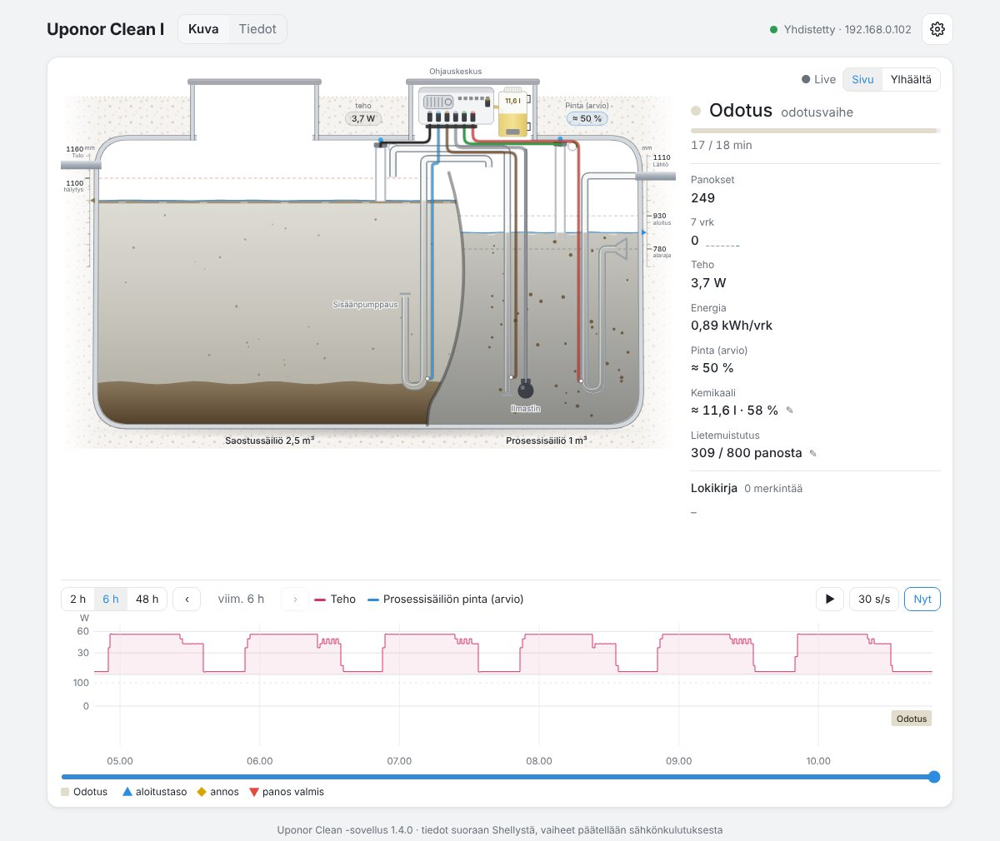
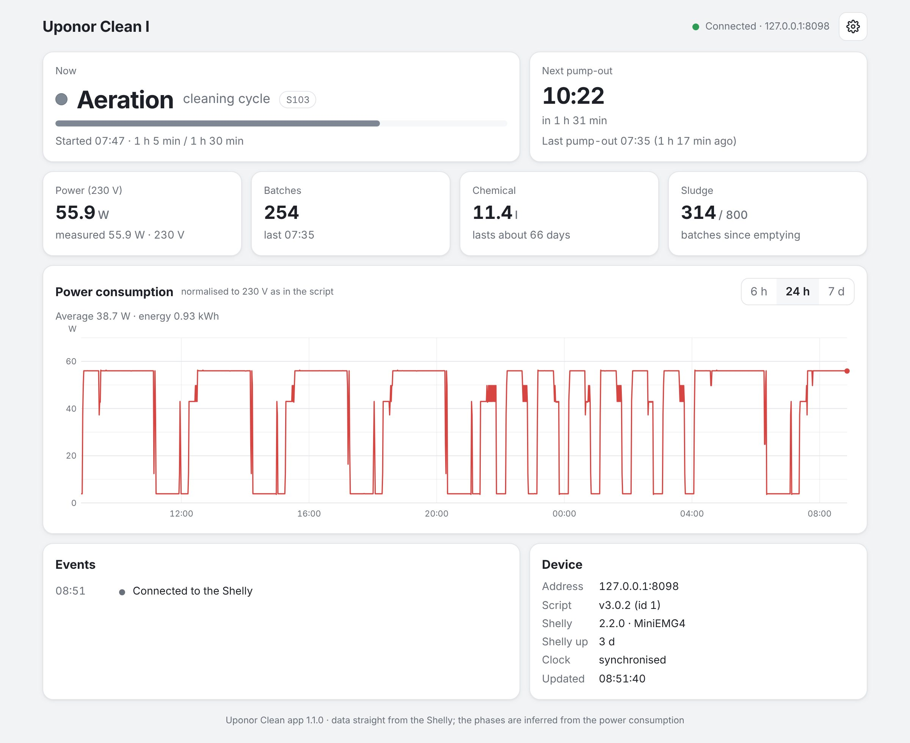
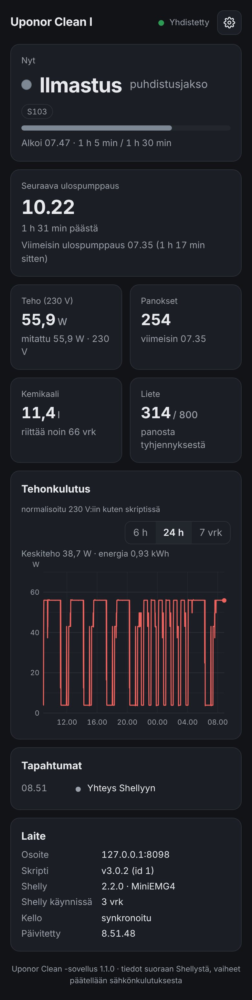

# Browser app

**English** | [Suomi](sovellus.md)

`app/uponor-clean-app.html` shows the state and power consumption of the plant straight from the Shelly. Home Assistant is not needed. The app is a single HTML file that loads nothing from the internet. The Shelly can serve it itself, and then it opens in the home network on a phone too.

The app has two views, switched next to the title: **Picture** and **Details**.



## Picture

The Picture view is the same drawing as on the Home Assistant card ([card guide](../ha-card/README.md)). It does not need Home Assistant: the card code is inside the app, and the data comes straight from the Shelly.

- the plant as a side section or from above, the hoses, the pump flows, the tank levels and the sludge blanket by phase
- the phase and its progress, the next pump-out, batches, power, energy per day, the level estimate, chemical and the sludge reminder
- a timeline with the power over 2, 6 or 48 hours; the timeline can be browsed and played, and the drawing then shows the chosen moment
- the logbook

The chemical amount and the sludge counter can be entered from the pencil icon. The app writes them straight to the Shelly script.

Power and energy come from the minute history the Shelly stores (about 7 days). The Shelly does not store the phases, batches or warnings. So the phases on the timeline, the logbook and the batches per day build up from when the app has been open. The browser remembers them for 8 days, but only in the same browser. When the app is opened for the first time, the timeline shows only the current phase.

## Details



- **Now**: phase, cycle and phase code (e.g. `S103`), when the phase started and its progress from the firmware phase times.
- **Next pump-out** as a clock time and the time until it. In the waiting cycle the app shows when the holiday programme starts if the start level is not reached. The last pump-out is shown too.
- **Power** normalised to 230 V (below it the measured power and voltage) about every 3 seconds, **batches**, **chemical** and how long it lasts, and the **sludge counter**.
- **Warnings** as a bar at the top of the page.
- **Power consumption** as a chart over 6 hours, 24 hours or 3 days. The chart is normalised to a voltage of 230 V with the same formula as in the script, so the voltage does not move the levels (aeration about 57 W, pump-in about 43 W). In the 6 and 24 hour views the chart has a point a minute, in the 3 day view a 5-minute average. Above the chart are the measured average power and energy of the range. The pointer shows the normalised power and the measured power and voltage.
- **Events** while the app is open: phase changes, completed batches, warnings, chemical and counter entries, and script starts.
- **Device**: script and Shelly versions, uptime and clock state.

The app is in Finnish or English (browser language, or chosen in the settings). The light and dark theme follow the operating system. On a narrow screen the sections stack.



## Opening

The app connects to the Shelly in the home network. The easiest way is to let the Shelly serve it.

### From the Shelly (recommended)

Two scripts go on the Shelly:

- `uponor-clean-app` is a small loader page. It starts with the Shelly and uses about 2 kB of memory (peak under 4 kB).
- `uponor-clean-app-data` and `uponor-clean-app-data2` are the app itself, packed (about 86,000 characters in all, at most 45,000 per script). They are never started; they are only storage. If the app grows, it continues in the scripts `-data3` and so on.

The easiest way is to let the app make the scripts itself. They can also be made in the Shelly web UI or with the Python tool. No way touches the detection script. The names must be exactly these, because the loader finds the app by its name and the app tells the detection script apart by name.

#### From the app settings (easiest)

1. Download `app/uponor-clean-app.html` from GitHub to the computer and open it in a browser (Chrome, Edge, Firefox or Safari).
2. Enter the Shelly address and connect.
3. Open the settings (gear icon) and press **Install on the Shelly**.

The app stores itself on the Shelly, starts the loader and shows the app address. Before writing it checks that at least 100 kB stays free on the Shelly (see [Space and Shelly firmware updates](#space-and-shelly-firmware-updates)), and at the end it reads the scripts back and compares them. The settings also show which version the Shelly has.

A new version is installed the same way: open it on the computer and press **Update the Shelly**. The installation also works from the app opened through Home Assistant.

#### In the web UI

1. Open the Shelly web UI (`http://<shelly-ip>/`), open **Scripts** and choose **Create script**. Name it `uponor-clean-app-data`.
2. On GitHub, open `app/uponor-clean-app-data.txt`, choose **Raw**, copy everything (Ctrl+A, Ctrl+C), paste it into the editor and save (disk icon). The file is at most 45,000 characters, so it fits the editor (at most 50,000 characters). Make the script `uponor-clean-app-data2` the same way from `uponor-clean-app-data2.txt` (and `-data3` and so on, if there are any). **Do not start this script and do not turn on Run on startup for it**: it is packed data, not program code.
3. Go back to **Scripts**, choose **Create script** and name it `uponor-clean-app`.
4. Paste the content of `app/uponor_clean_app_loader.js` into the editor the same way, save and start (**Start**). The console shows the line `Uponor Clean app: http://<shelly>/script/<id>/app`.
5. Go back to **Scripts** and turn on **Run on startup** for `uponor-clean-app`.

When the app is updated, delete the old `uponor-clean-app-data` (and any `-data2`, `-data3`) and make a new one as in steps 1–2. The loader usually needs no update.

#### With the Python tool

```
python3 shelly/tools/sovellus_shellyyn.py 192.168.0.102            # with a password: --salasana PASSWORD
```

The tool creates the scripts, compares them with what it reads back from the device and starts the loader. Like the app, in an update it first deletes the old data scripts, and it leaves at least 100 kB free on the Shelly. When the app is updated, run the tool again. `--poista` removes the app scripts.

#### The app address

After that the app opens on any device in the home network, a phone too, at `http://<shelly-ip>/script/<id>/app`, e.g. `http://192.168.0.102/script/3/app`. `<id>` is the number of the `uponor-clean-app` script (at the right edge of the Scripts list, e.g. `script:3`), and the full address shows in the app settings, the script console and the tool output. Type `http://` at the start. The app does not ask for the Shelly address, because the page comes from the Shelly. Home Assistant, another server or an internet connection is not needed. On a phone the page can be added to the home screen.

#### Update and removal

An update deletes the old app and puts the new one in its place. **Update the Shelly** first deletes the old `uponor-clean-app-data` scripts and then writes the new ones, so the Shelly never holds two versions at once. The loader `uponor-clean-app` stays and keeps its number, so the app address and the bookmark on the phone do not change.

If the installation stops, for example because the connection breaks, the Shelly can be left with an unfinished app whose address does not open. Press the button again and the installation starts over. The Shelly's file system can answer slowly right after a large script is deleted, so the installation waits 30 seconds for the answers.

**Remove from the Shelly** in the settings (press twice) or `sovellus_shellyyn.py <ip> --poista` removes the app scripts. The detection script stays.

#### Space and Shelly firmware updates

The scripts are in the same file system as the Shelly's own files and settings. On the test device (Shelly Mini EM Gen4, firmware 2.2.0) the file system is 768 kB, and with the app (1.4.0, 87 kB) about 116 kB is free.

Shelly does not say how much free space a firmware update needs. The firmware of the ESP32-based Shellys is based on Mongoose OS (which is why e.g. [mgos32-to-tasmota32](https://github.com/tasmota/mgos32-to-tasmota32) works through its update mechanism); for Gen4 this has not been confirmed. According to the Mongoose OS [guide](https://mongoose-os.com/docs/mongoose-os/userguide/ota.md), an update writes the new firmware and its file system to a separate partition and moves the user's files, such as scripts, there. If a step fails, the update is aborted and the old firmware stays in use. So the user's files must fit in the new firmware's file system.

That is why the app and the tool always leave at least 100 kB free. The limit is a safety margin, not a figure from Shelly. If a firmware update still fails, remove the app from the Shelly, update the firmware and install the app again.

### Other ways

1. **As a file**: download `app/uponor-clean-app.html` to the computer and open it in a browser. On a phone, opening a file depends on the browser, so on a phone use the Shelly address.
2. **Through Home Assistant**: copy the file to the Home Assistant folder `/config/www/` (like the card). The app then opens in the home network at `http://homeassistant.local:8123/local/uponor-clean-app.html`. Home Assistant only serves the file; the data comes straight from the Shelly.
3. **From another server in the home network** at an `http://` address (e.g. a NAS).

Opened this way, the app asks for the Shelly address the first time (e.g. `192.168.0.102`). The address can also be given in the link: `uponor-clean-app.html?host=192.168.0.102`. The app remembers it in the same browser. The language can be set in the link with `&lang=fi` or `&lang=en`.

A page opened from an `https://` address (e.g. GitHub Pages, Home Assistant remote access or a chat app preview) cannot connect. The browser blocks an unencrypted `ws://` connection from an encrypted page, and the Shelly has no encrypted local connection. The app says so.

**Away from home** the app works over a VPN connection to the home network. The data does not come through the Shelly cloud: the cloud API cannot read the script state or the power history.

## Password

If the Shelly has a password, the app asks for it. It uses the Shelly digest authentication (SHA-256). With *Remember the password on this device*, the browser stores a hash computed from the password, not the password itself. The hash still gives access to the Shelly, so do not use it on a shared computer.

The password support was tested with a Shelly mock that follows the Shelly documentation. It has not been tried on a real device, because the test device has no password.

## How it works

Everything goes through the Shelly WebSocket RPC (`ws://<shelly>/rpc`):

| Data | RPC call | Interval |
| --- | --- | --- |
| Script | `Script.List` (name starts with `uponor-clean`, not the app's own scripts) | when connecting |
| Script state | `Script.Eval` → `JSON.stringify(stateObject())` | 6 s and after an event |
| Power and voltage | `EM1.GetStatus` or `NotifyStatus` sent by the Shelly | 3 s |
| Events | the script's `uponor` events (`NotifyEvent`) | at once |
| Power history | `EM1Data.GetData` (one record a minute: energy, minimum and maximum power, voltage) | 7 days at first, then the new minutes every minute |
| Energy meter | `EM1Data.GetStatus` (`total_act_energy`) | every minute |
| Script components | `KVS.Get` → `uc_vc` (entering the chemical and the sludge counter with `Number.Set`) | when connecting |

The script's state endpoint `http://<shelly>/script/<id>/state` does not work for a browser: the Shelly answers 503 when an HTTP request carries the `Origin` header of another page (see [`shelly-limits.md`](shelly-limits.md)). So the app reads the same state with `Script.Eval`. The script needed no changes; the name of the function `stateObject()` is now part of the agreed interface.

The power of a minute is taken from its minimum and maximum power. The minute energy of the Shelly comes in steps of about 0.207 Wh, so an average power from it would jump in steps of 12.4 W (see [`shelly-limits.md`](shelly-limits.md)). If the power changed during the minute, the energy average is used, kept between the minimum and maximum. The power is normalised with (P − 4) · (230 / U)² + 4 when P is over 10 W.

When the Shelly serves the app, the loader page reads the packed app from the same address with `Script.GetCode` requests, unpacks it in the browser and opens it. The requests go to the same address as the page, so the `Origin` limit does not apply to them.

The Picture view is the Home Assistant card `ha-card/uponor-clean-card.js` as it is. `app/tools/build_app.js` puts it into the app (minified if terser is installed: `npm install --no-save terser@5.31.6`) and makes the packed files again. The app gives the card a small stand-in for Home Assistant: the script state as entities, their history from the browser's memory, the power history and the energy meter from the Shelly, and `number.set_value` as the Shelly `Number.Set` call on the script's components.

**Install on the Shelly** stores the page as the browser loaded it (`document.documentElement.outerHTML` before the script changes the page), packs it in the browser (gzip and base64, 76-character lines) and writes it over the WebSocket with `Script.PutCode` calls in 1,024-character pieces. The loader code is inside the app, the same as in `app/uponor_clean_app_loader.js`.

The app does not show the phase history, because the Shelly does not store it. The event log starts when the app is opened.

## Testing without the device

`test/shelly_ws_mock.js` runs the real v3 script in the Shelly mock over a simulated plant and answers the same WebSocket calls as the Shelly:

```
node test/shelly_ws_mock.js --port 8098 --days 3
# open app/uponor-clean-app.html?host=127.0.0.1:8098
node test/shelly_ws_mock.js --port 8097 --days 1 --password secret   # with a password
```

The mock first simulates the given number of days (about 10 s per day) and then runs in real time.

The mock can also store scripts and answer their HTTP addresses, so the installation on the Shelly can be tried with it:

```
python3 shelly/tools/sovellus_shellyyn.py 127.0.0.1:8098
# open http://127.0.0.1:8098/script/<id>/app
```

`test/app_picture_test.js` tries the Picture view: the card, the phase, the power history, the energy, the history kept in the browser, entering the chemical and the sludge counter, and the language change.

`test/app_install_test.js` tries the Install on the Shelly button against the mock with Playwright: installing from a file, opening the app served by the Shelly, installing in several parts, the Python tool, too little space and three running scripts.
