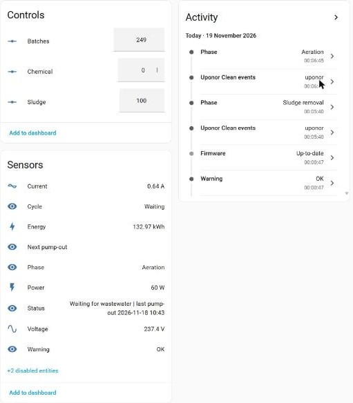
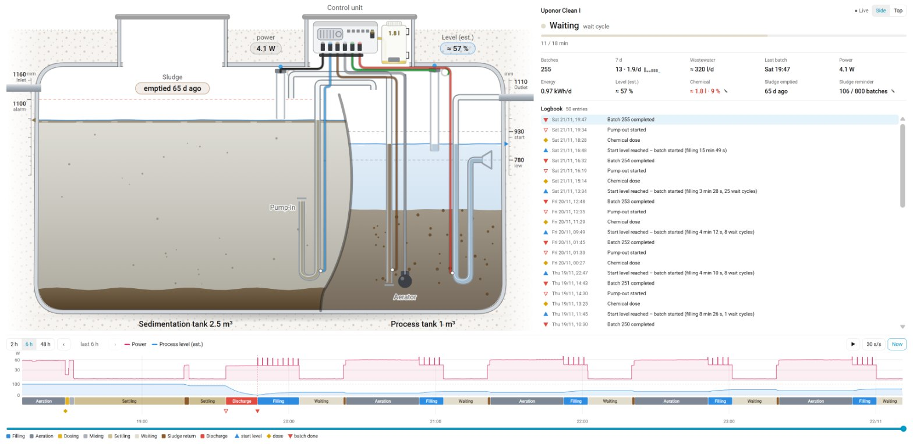

# Uponor Clean – Home Assistant

**English** | [Suomi](home-assistant.md)

Home Assistant's Shelly integration turns the components of Shelly script v3 into entities and the script's events into an event entity. They can drive notifications and automations, and the Lovelace card shows the plant animated.

Tested on Home Assistant 2026.10.2 with its built-in Shelly integration.

- Installing the script on the Shelly: [`v3-install.md`](v3-install.md)
- The card: [`ha-card/README.md`](../ha-card/README.md)

## 1. Shelly integration

Home Assistant usually finds the Shelly by itself (**Settings → Devices & services**, *Discovered*). Otherwise add it: **Add integration → Shelly** and the Shelly's IP address.

Once the script is installed and has created its components, reload the integration: **Settings → Devices & services → Shelly → the device → ⋮ → Reload**. The integration reads the components only when it is reloaded or Home Assistant starts. Do the same if a script update adds components.

The device page gets the controls Batches, Chemical and Sludge and the sensors Phase, Cycle, Status, Warning and Next pump-out. The Shelly's own measurements (power, energy, voltage, current) are on the same page.



## 2. Entities

The entity ids depend on the device name in Home Assistant. The ids in the table are from this installation; yours are on the device page.

| Component | Entity (example) | State |
| --- | --- | --- |
| Phase | `sensor.storage_room_uponor_clean_1_phase` | Pre-aeration, Aeration, Chemical filling, Dosing, Mixing, Sedimentation I, Sludge removal, Sedimentation II, Pump-out, Pump-in, Waiting, No power, Unknown |
| Cycle | `sensor.storage_room_uponor_clean_1_cycle` | Cleaning, Waiting, Holiday, Test, Unknown |
| Status | `sensor.storage_room_uponor_clean_1_status` | Text, e.g. "Pump-out at 14:35 (in 1 h 12 min)" |
| Warning | `sensor.storage_room_uponor_clean_1_warning` | `OK` or the title of the most important warning |
| Next pump-out | `sensor.storage_room_uponor_clean_1_next_pump_out` | Local ISO time, empty when not known |
| Batches | `number.storage_room_uponor_clean_1_batches` | Batch counter, editable |
| Chemical | `number.storage_room_uponor_clean_1_chemical` | Chemical (l), editable |
| Sludge | `number.storage_room_uponor_clean_1_sludge` | Batches since the sludge was emptied, editable |
| Script events | `event.storage_room_uponor_clean_1_events` | See section 3 |

The state of the Phase, Cycle and Warning sensors is the component's title (e.g. `Aeration`, `Waiting`, `OK`). Use the titles in automations. The warning titles and their meaning are in the installation guide ([Components](v3-install.md#components)).

Batches, Chemical and Sludge can be changed on the device page, on the card or with the `number.set_value` action. The script continues counting from the new value.

## 3. Events

The integration creates an event entity for the script, disabled by default. Enable it on the device page: **+N disabled entities → the entity → ⚙ → Enabled**. The integration names it after the script (e.g. `event.storage_room_uponor_clean_1_uponor_clean_v3`). In this installation it was renamed `event.storage_room_uponor_clean_1_events`.

The entity's state is the time of the latest event, and the event's data are in its attributes. Every event has `event_type: uponor`, `type`, `v` (event format version, now 1) and `ts` (Unix time).

| `type` | When | Other attributes |
| --- | --- | --- |
| `phase` | The phase or cycle changed | `cycle`, `phase` (key, e.g. `pump_out`), `code` (the firmware's phase code), `eta` (next pump-out, Unix time or `null`) |
| `warning` | A warning started or ended | `key` (warning key), `on` (`true` or `false`) |
| `batch` | A batch finished or the counter was changed | `n` (batches), `user: true` if a user changed it |
| `chemical` | A dose or a chemical entry | `l` (litres), `days` (days left), `user` |
| `sludge` | The sludge counter changed | `n`, `reset` (time of the reset), `user` |
| `start` | The script started | `reason` (`power_cut` or `restart`), `version` |

The integration looks for a script's events only in the first 5 kB of the script. The second line of the compact version mentions `Shelly.emitEvent("uponor", …)`, so the event entity gets created. Keep that line if you edit the start of the script.

## 4. Automations

Paste the examples into an automation's YAML editor: **Settings → Automations & scenes → Create automation → ⋮ → Edit in YAML**. Replace `notify.notify` with your own notification service, e.g. `notify.mobile_app_<phone>`.

### Notification on a warning

The Warning sensor shows the most important warning. The notification comes when it changes to anything but `OK`.

```yaml
alias: Uponor Clean – warning
triggers:
  - trigger: state
    entity_id: sensor.storage_room_uponor_clean_1_warning
    not_to: [OK, unavailable, unknown]
    not_from: [unavailable, unknown]
actions:
  - action: notify.notify
    data:
      title: Uponor Clean
      message: "{{ trigger.to_state.state }} – {{ states('sensor.storage_room_uponor_clean_1_status') }}"
```

### Every warning from the events

The event entity reports the start and end of every warning, also while a more important warning is already on.

```yaml
alias: Uponor Clean – warnings
triggers:
  - trigger: state
    entity_id: event.storage_room_uponor_clean_1_events
    not_from: [unavailable, unknown]
conditions:
  - condition: template
    value_template: "{{ trigger.to_state.attributes.type == 'warning' }}"
actions:
  - action: notify.notify
    data:
      title: Uponor Clean
      message: >-
        {{ trigger.to_state.attributes.key }}
        {{ 'started' if trigger.to_state.attributes.on else 'cleared' }}
```

`not_from` prevents a repeated notification when the integration reloads and the entity returns from `unavailable` to the previous event.

### Batch finished

```yaml
alias: Uponor Clean – batch finished
triggers:
  - trigger: state
    entity_id: event.storage_room_uponor_clean_1_events
    not_from: [unavailable, unknown]
conditions:
  - condition: template
    value_template: >-
      {{ trigger.to_state.attributes.type == 'batch'
         and not trigger.to_state.attributes.user | default(false) }}
actions:
  - action: notify.notify
    data:
      title: Uponor Clean
      message: "Batch {{ trigger.to_state.attributes.n }} finished"
```

## 5. The card

The Lovelace card `ha-card/uponor-clean-card.js` shows the plant as a cross-section, a timeline and a logbook. Installation, options and entering chemical and sludge: [`ha-card/README.md`](../ha-card/README.md).



## Troubleshooting

| Symptom | Cause and fix |
| --- | --- |
| No entities | Reload the Shelly integration (section 1). Check on the Shelly's **Components** page that the script has created the components. |
| No event entity | It is disabled by default (section 3). If it is not there even as disabled, check that the script's second line has `Shelly.emitEvent("uponor"` and reload the integration. |
| Entities are `unavailable` for a moment | An integration reload, a Shelly restart or a network outage. The integration also reloads when the Shelly's settings change (e.g. a script is saved), and all entities are then `unavailable` for less than a second. The card's logbook shows only breaks of 10 seconds or more as *Data gap*. |
| Phase stays `Unknown` for a long time | See the troubleshooting in the installation guide ([`v3-install.md`](v3-install.md#troubleshooting)). |
