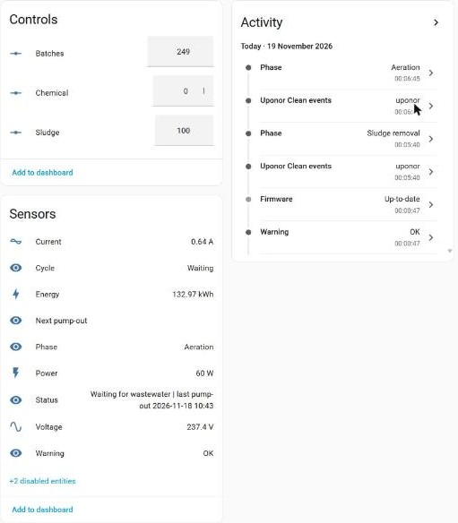
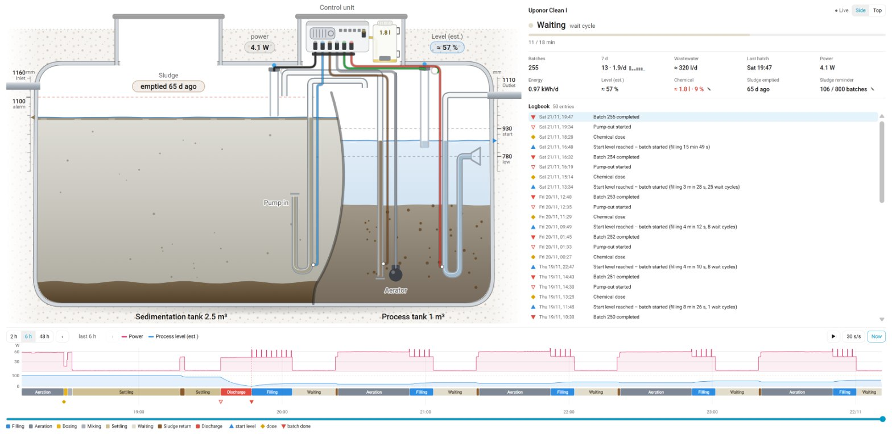

# Uponor Clean – Home Assistant

[English](home-assistant.en.md) | **Suomi**

Home Assistantin Shelly-integraatio tuo Shelly-skriptin v3 komponentit entiteeteiksi ja skriptin tapahtumat tapahtumaentiteetiksi. Niillä voi tehdä ilmoituksia ja automaatioita, ja Lovelace-kortti näyttää puhdistamon animoituna.

Testattu Home Assistant 2026.10.2:lla ja sen sisäänrakennetulla Shelly-integraatiolla.

- Skriptin asennus Shellyyn: [`v3-asennus.md`](v3-asennus.md)
- Kortti: [`kortti.md`](kortti.md)

## 1. Shelly-integraatio

Home Assistant löytää Shellyn yleensä itse (**Settings → Devices & services**, *Discovered*). Muuten lisää se: **Add integration → Shelly** ja Shellyn IP-osoite.

Kun skripti on asennettu ja se on luonut komponenttinsa, lataa integraatio uudelleen: **Settings → Devices & services → Shelly → laite → ⋮ → Reload**. Integraatio lukee komponentit vain uudelleenlatauksessa ja Home Assistantin käynnistyksessä. Tee sama, jos skriptin päivitys tuo uusia komponentteja.

Laitteen sivulle tulevat ohjaimet Batches, Chemical ja Sludge sekä sensorit Phase, Cycle, Status, Warning ja Next pump-out. Shellyn omat mittaukset (teho, energia, jännite, virta) ovat samalla sivulla.



## 2. Entiteetit

Tunnukset riippuvat laitteen nimestä Home Assistantissa. Taulukon tunnukset ovat tästä asennuksesta, ja omasi näet laitteen sivulta.

| Komponentti | Entiteetti (esimerkki) | Tila |
| --- | --- | --- |
| Phase | `sensor.storage_room_uponor_clean_1_phase` | Pre-aeration, Aeration, Chemical filling, Dosing, Mixing, Sedimentation I, Sludge removal, Sedimentation II, Pump-out, Pump-in, Waiting, No power, Unknown |
| Cycle | `sensor.storage_room_uponor_clean_1_cycle` | Cleaning, Waiting, Holiday, Test, Unknown |
| Status | `sensor.storage_room_uponor_clean_1_status` | Teksti, esim. "Pump-out at 14:35 (in 1 h 12 min)" |
| Warning | `sensor.storage_room_uponor_clean_1_warning` | `OK` tai tärkeimmän varoituksen otsikko |
| Next pump-out | `sensor.storage_room_uponor_clean_1_next_pump_out` | Paikallinen ISO-aika, tyhjä kun ei tiedossa |
| Batches | `number.storage_room_uponor_clean_1_batches` | Panoslaskuri, muokattavissa |
| Chemical | `number.storage_room_uponor_clean_1_chemical` | Kemikaali (l), muokattavissa |
| Sludge | `number.storage_room_uponor_clean_1_sludge` | Panokset lietteen tyhjennyksestä, muokattavissa |
| Skriptin tapahtumat | `event.storage_room_uponor_clean_1_events` | Ks. kohta 3 |

Phase-, Cycle- ja Warning-sensorien tila on komponentin otsikko (esim. `Aeration`, `Waiting`, `OK`). Käytä otsikoita automaatioissa. Varoitusten otsikot ja merkitykset ovat asennusohjeen taulukossa ([Komponentit](v3-asennus.md#komponentit)).

Batches-, Chemical- ja Sludge-arvoja voi muuttaa laitteen sivulla, kortilla tai toiminnolla `number.set_value`. Skripti jatkaa laskentaa uudesta arvosta.

## 3. Tapahtumat

Integraatio luo skriptille tapahtumaentiteetin, joka on oletuksena pois käytöstä. Ota se käyttöön laitteen sivulla: **+N disabled entities → entiteetti → ⚙ → Enabled**. Integraatio nimeää sen skriptin mukaan (esim. `event.storage_room_uponor_clean_1_uponor_clean_v3`). Tässä asennuksessa se on nimetty uudelleen `event.storage_room_uponor_clean_1_events`.

Entiteetin tila on viimeisimmän tapahtuman aika, ja tapahtuman tiedot ovat attribuuteissa. Kaikissa tapahtumissa ovat `event_type: uponor`, `type`, `v` (tapahtumamuodon versio, nyt 1) ja `ts` (Unix-aika).

| `type` | Milloin | Muut attribuutit |
| --- | --- | --- |
| `phase` | Vaihe tai jakso vaihtui | `cycle`, `phase` (avain, esim. `pump_out`), `code` (firmwaren vaihekoodi), `eta` (seuraava ulospumppaus, Unix-aika tai `null`) |
| `warning` | Varoitus alkoi tai päättyi | `key` (varoituksen avain), `on` (`true` tai `false`) |
| `batch` | Panos valmis tai laskuria muutettiin | `n` (panokset), `user: true`, jos käyttäjä muutti |
| `chemical` | Annostelu tai kemikaalin syöttö | `l` (litraa), `days` (riittää päivää), `user` |
| `sludge` | Lietelaskuri muuttui | `n`, `reset` (nollauksen aika), `user` |
| `start` | Skripti käynnistyi | `reason` (`power_cut` tai `restart`), `version` |

Integraatio löytää skriptin tapahtumat vain skriptin ensimmäisestä 5 kt:sta. Tiivistetyn version toinen rivi mainitsee `Shelly.emitEvent("uponor", …)`, joten tapahtumaentiteetti syntyy. Jos muokkaat skriptin alkua, säilytä tämä rivi.

## 4. Automaatiot

Esimerkit liitetään automaation YAML-editoriin: **Settings → Automations & scenes → Create automation → ⋮ → Edit in YAML**. Vaihda `notify.notify` omaan ilmoituspalveluusi, esim. `notify.mobile_app_<puhelin>`.

### Ilmoitus varoituksesta

Warning-sensori näyttää tärkeimmän varoituksen. Ilmoitus tulee, kun se vaihtuu muuksi kuin `OK`.

```yaml
alias: Uponor Clean – varoitus
triggers:
  - trigger: state
    entity_id: sensor.storage_room_uponor_clean_1_warning
    not_to: [OK, unavailable, unknown]
    not_from: [unavailable, unknown]
actions:
  - action: notify.notify
    data:
      title: Uponor Clean
      message: "{{ trigger.to_state.state }} – {{ states('sensor.storage_room_uponor_clean_1_status') }}"
```

### Jokainen varoitus tapahtumasta

Tapahtumaentiteetti kertoo jokaisen varoituksen alun ja lopun, myös silloin, kun tärkeämpi varoitus on jo päällä.

```yaml
alias: Uponor Clean – varoitukset
triggers:
  - trigger: state
    entity_id: event.storage_room_uponor_clean_1_events
    not_from: [unavailable, unknown]
conditions:
  - condition: template
    value_template: "{{ trigger.to_state.attributes.type == 'warning' }}"
actions:
  - action: notify.notify
    data:
      title: Uponor Clean
      message: >-
        {{ trigger.to_state.attributes.key }}
        {{ 'alkoi' if trigger.to_state.attributes.on else 'poistui' }}
```

`not_from` estää uuden ilmoituksen, kun integraatio ladataan uudelleen ja entiteetti palaa tilasta `unavailable` edelliseen tapahtumaan.

### Panos valmis

```yaml
alias: Uponor Clean – panos valmis
triggers:
  - trigger: state
    entity_id: event.storage_room_uponor_clean_1_events
    not_from: [unavailable, unknown]
conditions:
  - condition: template
    value_template: >-
      {{ trigger.to_state.attributes.type == 'batch'
         and not trigger.to_state.attributes.user | default(false) }}
actions:
  - action: notify.notify
    data:
      title: Uponor Clean
      message: "Panos {{ trigger.to_state.attributes.n }} valmis"
```

## 5. Kortti

Lovelace-kortti `ha-card/uponor-clean-card.js` näyttää puhdistamon leikkauskuvana, aikajanana ja lokikirjana. Asennus, asetukset ja kemikaalin ja lietteen syöttö: [`kortti.md`](kortti.md).



## Vianetsintä

| Oire | Syy ja korjaus |
| --- | --- |
| Entiteettejä ei näy | Lataa Shelly-integraatio uudelleen (kohta 1). Tarkista Shellyn **Components**-sivulta, että skripti on luonut komponentit. |
| Tapahtumaentiteettiä ei ole | Se on oletuksena pois käytöstä (kohta 3). Jos sitä ei ole edes käytöstä poistettuna, tarkista, että skriptin toisella rivillä on `Shelly.emitEvent("uponor"`, ja lataa integraatio uudelleen. |
| Entiteetit ovat hetken `unavailable` | Integraation uudelleenlataus, Shellyn uudelleenkäynnistys tai verkkokatko. Kortin lokikirjassa näkyy *Datakatko*. |
| Phase on pitkään `Unknown` | Ks. asennusohjeen vianetsintä ([`v3-asennus.md`](v3-asennus.md#vianetsintä)). |
