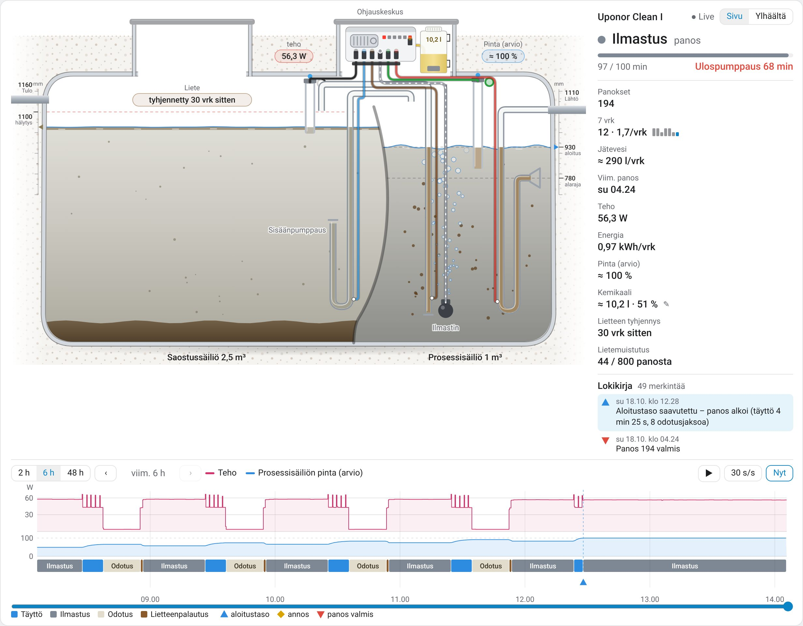
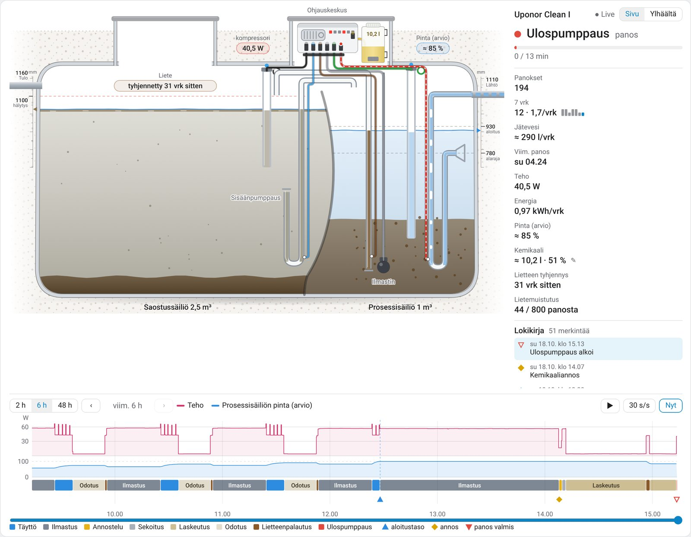
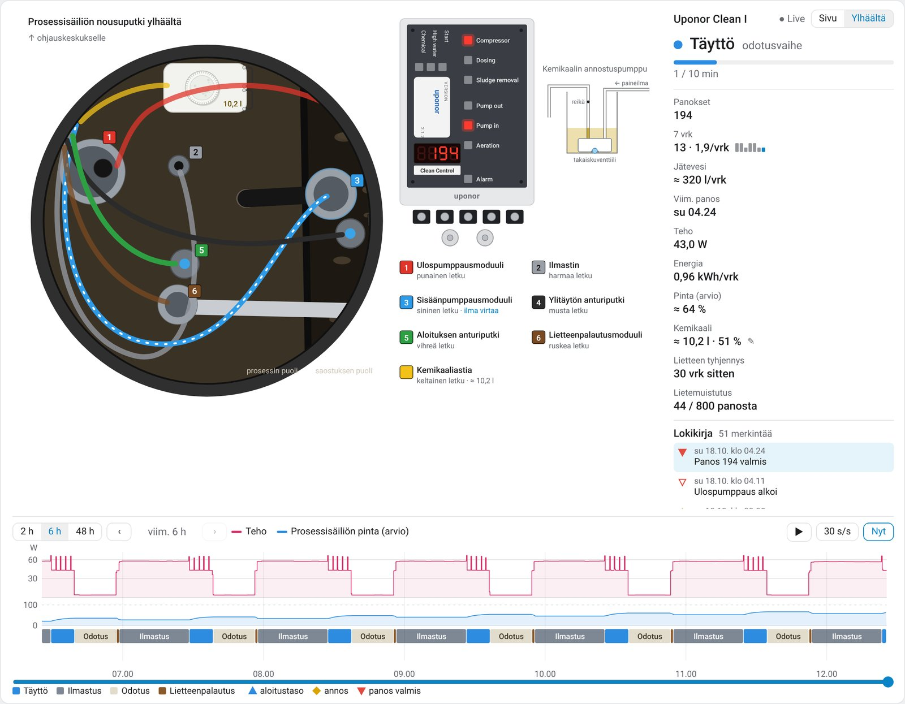
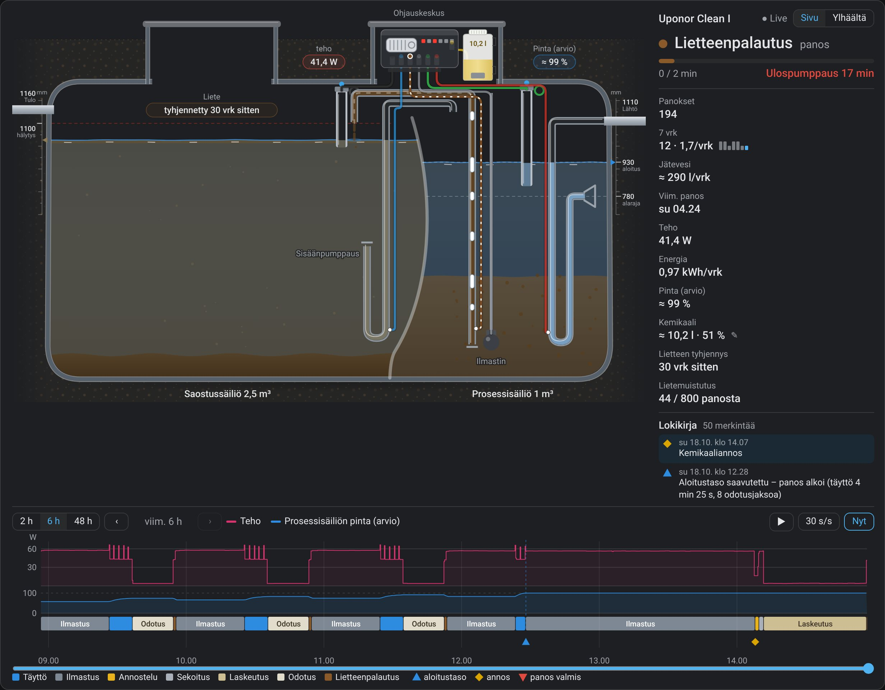
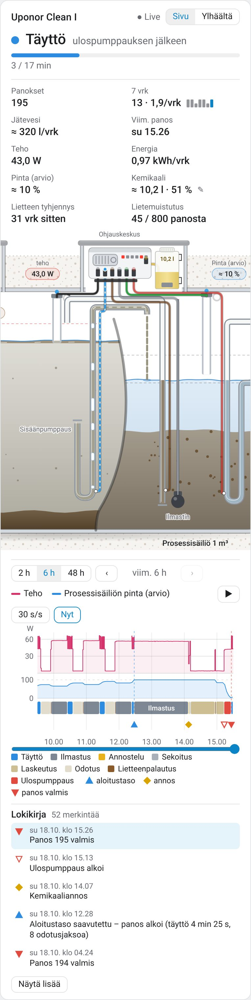
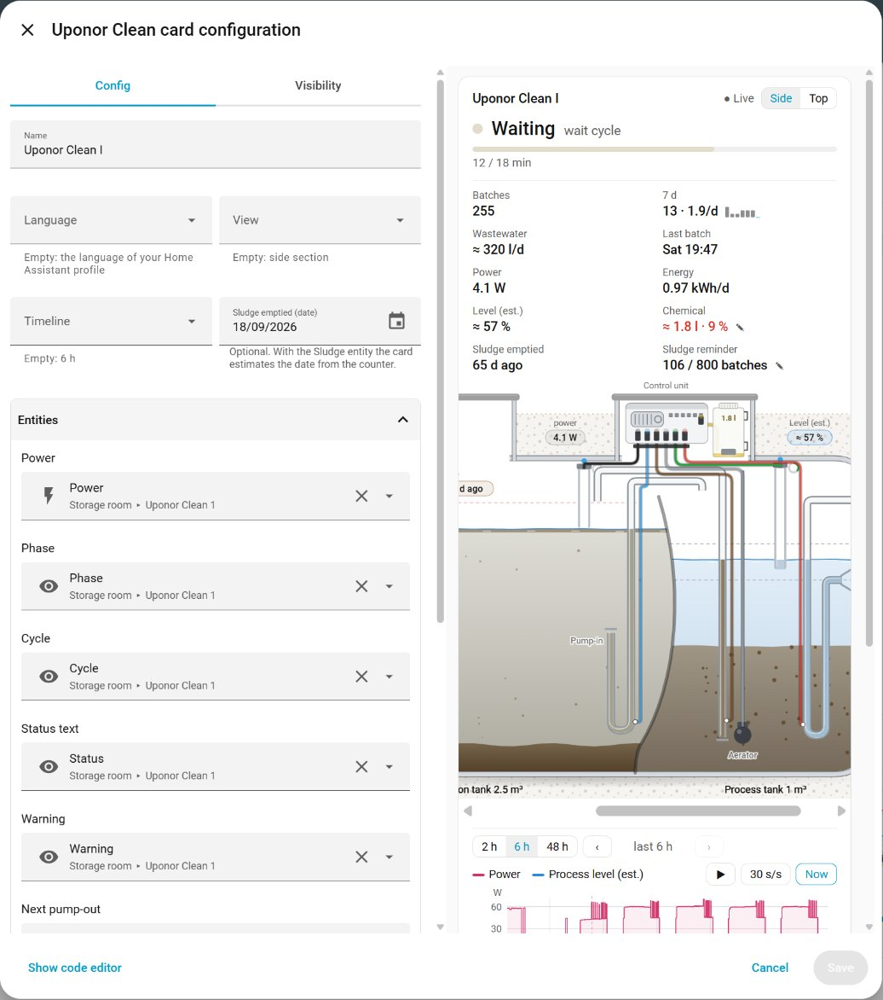
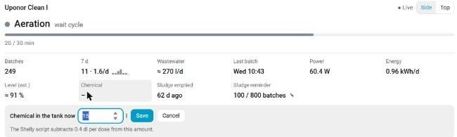
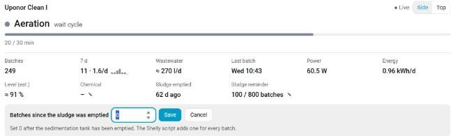
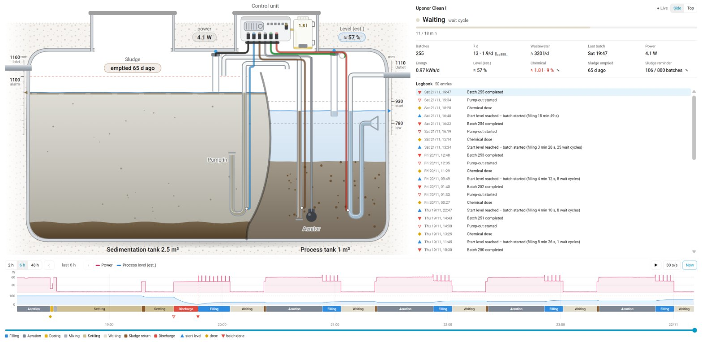

# Uponor Clean -kortti Home Assistantiin

[English](../ha-card/README.md) | **Suomi**

Kortti `ha-card/uponor-clean-card.js` näyttää puhdistamon Home Assistantissa: leikkauskuvan ja prosessisäiliön nousuputken ylhäältä, animoituna sen mukaan, mitä ohjauskeskus tekee. Alla on aikajana, jota voi selata ja toistaa, ja oikealla lukemat ja lokikirja. Tiedot tulevat Shelly-skriptin v3 entiteeteistä ([`home-assistant.md`](home-assistant.md)). Kortti toimii myös v2.3- ja v2.4-skriptin entiteeteillä.



[Kokeile korttia demossa](https://claude.ai/artifact/PnR5ZpnUjHt1qFZEd3TTut): se pyörii selaimessa tallennetulla datalla.

## Mitä kortti näyttää

**Leikkauskuva** perustuu valmistajan poikkileikkaukseen (Clean I -käsikirja, s. 18): saostussäiliö (2,5 m³), prosessisäiliö (1 m³) ja niiden välinen kaareva väliseinä, ohjauskeskus kompressoreineen ja venttiileineen, kemikaaliastia, sisäänpumppaus-, lietteenpalautus- ja ulospumppausmoduuli, ilmastin sekä aloitus- ja hälytystason anturiputket.

- Mammuttipumput: ilma puhalletaan nousuputken alaosaan, ja vesi purkautuu sykäyksinä. Ulospumppauksessa virtaus heikkenee pinnan laskiessa.
- Ilmastus: kuplat nousevat ilmastimesta ja liete kiertää. Laskeutuksessa liete painuu pohjaan ja pinnalle muodostuu kirkas vesikerros.
- Annostelu: kemikaalipumpun kammio täyttyy ja paineilma nostaa annoksen.
- Anturiputket: aloitustason (vihreä letku) ja hälytystason (musta letku) ilmapatsas ja paineen osoitin. Anturit ovat 10 mbar:n painekytkimiä. Kytkin laukeaa, kun vesi on noin 10 cm putken avoimen pään yläpuolella (10 mbar ≈ 102 mm vesipatsasta, ja lisäksi loukkuun jäänyt ilma puristuu hieman kokoon). Siksi putkien päät on piirretty noin 105 mm laukaisutasojen alapuolelle: vihreä noin 825 mm:iin (aloitustaso noin 930 mm) ja musta noin 995 mm:iin (hälytystaso noin 1100 mm). Vihreän putken pää on ulospumppaustason (noin 780 mm) yläpuolella, joten ilmapatsas nollautuu jokaisen ulospumppauksen jälkeen.
- Venttiilien letkut syttyvät sen mukaan, mitä ohjauskeskus ohjaa.
- Pinnat ovat arvioita vaiheiden historiasta, eivät mittauksia.



**Ylhäältä**-näkymä näyttää prosessisäiliön nousuputken moduulit samoilla letkuväreillä kuin Uponorin moduulikuvassa ja Clean Control -paneelin valot ja näytön (panoslaskuri).



**Oikea palsta**: vaihe ja jakso (esim. *Ilmastus · panos*), vaiheen eteneminen firmwaren vaiheajoista, seuraava ulospumppaus, panokset, viimeisen 7 vuorokauden panokset päivittäin, jätevesi (panokset × 170 l), viimeisin panos, teho, energia vuorokaudessa, prosessisäiliön pinta (arvio), kemikaali, lietteen tyhjennys ja lietemuistutus. Varoitukset näkyvät palkkina otsikon alla.

**Lokikirja**: panos alkoi (täyttöaika ja odotusjaksojen määrä), kemikaaliannos, ulospumppaus, panos valmis, loma-automatiikka, sähkökatkon jälkeinen uudelleenkäynnistys, varoitukset ja datakatkot. Merkintää napsauttamalla aikajana siirtyy siihen hetkeen.

**Aikajana**: 2, 6 tai 48 tuntia, teho, prosessisäiliön pinta (arvio), vaihepalkki ja tapahtumat. ▶ toistaa historiaa (1 s/s – 5 min/s), ja liukusäätimellä voi siirtyä mihin tahansa hetkeen. **Nyt** palaa reaaliaikaan.

**Tumma teema** ja **kapea näyttö**: kortti seuraa Home Assistantin teemaa. Kapealla näytöllä palsta siirtyy kuvan yläpuolelle ja kuva vierii sivusuunnassa.





## Kieli

Kortti on suomeksi tai englanniksi. Oletuksena se käyttää Home Assistant -profiilin kieltä (*Profiili → Kieli*). Kielen voi valita kortin asetuksista (**Kieli**: tyhjä = profiilin kieli, *Suomi* tai *English*) tai YAML:ssa `language: fi`. Valinta koskee kaikkia, jotka katsovat samaa näkymää. Kortin omaa kielivalitsinta ei tarvita, koska kieli on näkymäkohtainen asetus.

Shelly-skriptin tekstit (Status, varoitusten otsikot) ovat englanniksi. Kortti kääntää vaiheet ja varoitukset itse, joten ne näkyvät valitulla kielellä.

## Asennus

1. Kopioi `ha-card/uponor-clean-card.js` Home Assistantin kansioon `/config/www/` (esim. File editor -lisäosalla tai Samballa).
2. **Settings → Dashboards → ⋮ → Resources → Add resource**
   - URL: `/local/uponor-clean-card.js?v=1.7.3`
   - Tyyppi: **JavaScript module**

   Vaihda `?v=`-numero aina, kun korvaat tiedoston, jotta selaimet lataavat uuden version.
3. Lisää kortti näkymään (testattu Home Assistant 2026.10.2:lla). Kortti on tehty koko leveydelle: käytä **Panel**-näkymää tai **Sections**-näkymää, jossa kortti on koko leveä. Kortinvalitsimesta (*Uponor Clean Card*) lisätty kortti etsii v3-entiteetit itse.

## Asetukset

Kortin asetukset avautuvat muokkaustilassa (**Edit**). Lomakkeella valitaan nimi, kieli, näkymä, aikajanan pituus, lietteen tyhjennyspäivä, entiteetit ja puhdistamon asetukset.



Sama YAML:na (**Show code editor**):

```yaml
type: custom:uponor-clean-card
name: Uponor Clean I
entities:
  power: sensor.uponor_clean_1_power
  phase: sensor.storage_room_uponor_clean_1_phase
  cycle: sensor.storage_room_uponor_clean_1_cycle
  message: sensor.storage_room_uponor_clean_1_status
  warning: sensor.storage_room_uponor_clean_1_warning
  next_pumpout: sensor.storage_room_uponor_clean_1_next_pump_out
  batch_counter: number.storage_room_uponor_clean_1_batches
  chemical: number.storage_room_uponor_clean_1_chemical
  sludge: number.storage_room_uponor_clean_1_sludge
  energy: sensor.uponor_clean_1_energy
sludge_emptied: "2026-09-18"
```

| Asetus | Oletus | Merkitys |
| --- | --- | --- |
| `name` | `Uponor Clean I` | Otsikko |
| `language` | `auto` | `auto` (profiilin kieli), `fi` tai `en` |
| `view` | `side` | Aloitusnäkymä: `side` (leikkauskuva) tai `top` (ylhäältä) |
| `hours` | `6` | Aikajanan pituus: 2, 6 tai 48 |
| `entities.power` | – | Teho (W) |
| `entities.phase` | – | v3: Phase |
| `entities.cycle` | – | v3: Cycle |
| `entities.message` | – | v3: Status (v2: prosessiviesti) |
| `entities.warning` | – | v3: Warning |
| `entities.next_pumpout` | – | v3: Next pump-out |
| `entities.batch_counter` | – | Panoslaskuri (v3: Batches) |
| `entities.chemical` | – | v3: Chemical. Kemikaaliarvoa napsauttamalla voi syöttää määrän. |
| `entities.sludge` | – | v3: Sludge. Lietemuistutusta napsauttamalla voi nollata laskurin. |
| `entities.energy` | – | Energia (kWh, kokonais), valinnainen |
| `legacy` | – | Vanhat entiteetit (`status`, `message`, `batch_counter`), joiden historia näytetään ennen nykyisten alkua |
| `sludge_emptied` | – | Lietteen tyhjennyspäivä (`YYYY-MM-DD`), valinnainen |
| `sludge_reminder_batches` | `800` | Lietemuistutuksen raja panoksina |
| `batch_volume` | `170` | Panoksen koko (l) jätevesiarviota varten |
| `chemical_capacity` | `20` | Kemikaaliastian koko (l) prosenttia varten |
| `history_days` | `8` | Ladattavan historian pituus (vrk) |

v2-skriptin asetukset (`status`, `sludge_reset_counter`, `chemical_amount`, `chemical_refill_counter` ym.) on kuvattu tiedostossa `ha-card/README.md`.

## Kemikaali ja liete kortilla

**Kemikaali**: napsauta kemikaaliarvoa, syötä astiassa nyt oleva määrä litroina ja tallenna. Kortti kirjoittaa sen Shellyn Chemical-komponenttiin, ja skripti vähentää 0,4 dl jokaisesta annostelusta. Alle 10 päivän kulutuksella tulee varoitus.



**Liete**: kun saostussäiliö on tyhjennetty, napsauta lietemuistutusta, jätä arvoksi 0 ja tallenna. Lietelaskuri alkaa alusta, ja muistutus tulee 800 panoksen kohdalla. Vihjeteksti näyttää arvion jäljellä olevista päivistä.



*Lietteen tyhjennys* -päivä tulee laskurin nollauksesta, kun se näkyy ladatussa historiassa. Muuten kortti käyttää asetusta `sludge_emptied`. Jos asetettu päivä ei enää sovi laskuriin (liete on tyhjennetty sen jälkeen), kortti arvioi päivän laskurista ja panostahdista ja merkitsee sen ≈-merkillä.

## Oikealla laitteella



## Vianetsintä

| Oire | Korjaus |
| --- | --- |
| Kortti ei näy, *Custom element doesn't exist* | Tarkista resurssin osoite ja tyyppi (JavaScript module) ja lataa sivu uudelleen. |
| Vanha versio näkyy päivityksen jälkeen | Vaihda resurssin `?v=`-numero ja tyhjennä selaimen välimuisti. |
| *Odotetaan historiaa…* jää näkyviin | Recorder ei ole käytössä tai entiteetit ovat väärät. Tarkista entiteetit asetuksista. |
| Vaihe on *Tuntematon* | Shelly-skripti ei ole vielä tunnistanut vaihetta, tai teho puuttuu. Ks. `docs/v3-asennus.md`. |
| Lokikirjassa *Datakatko (Shelly tai Home Assistant)* | Home Assistant tai Shelly ei tallentanut lukemia vähintään 10 sekuntiin (esim. sähkö- tai verkkokatko, Home Assistantin päivitys). Lyhyemmät katkot, kuten Shelly-integraation uudelleenlataus Shellyn asetusten muuttuessa, eivät näy: kortti käyttää niiden ajan viimeistä tunnettua arvoa. |
