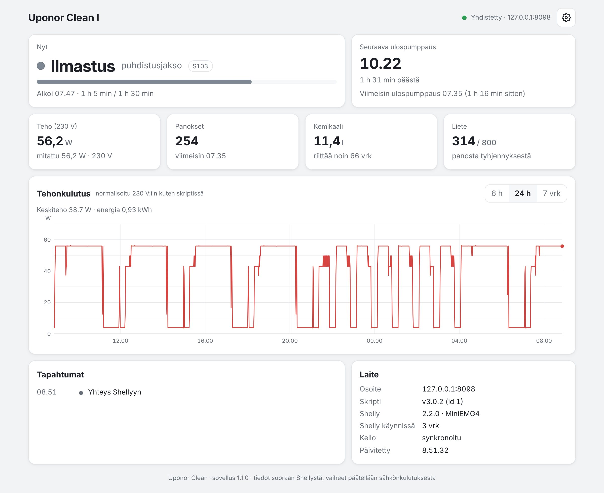

# Selainsovellus

[English](app.md) | **Suomi**

`app/uponor-clean-app.html` näyttää puhdistamon tilan ja sähkönkulutuksen suoraan Shellystä. Home Assistantia ei tarvita. Sovellus on yksi HTML-tiedosto, joka ei hae mitään internetistä. Shelly voi jakaa sen itse, jolloin se aukeaa kotiverkossa myös puhelimella.



## Mitä sovellus näyttää

- **Nyt**: vaihe, jakso ja vaihekoodi (esim. `S103`), vaiheen alkamisaika ja eteneminen firmwaren vaiheajoista.
- **Seuraava ulospumppaus** kellonaikana ja aikana siihen. Odotusjaksossa sovellus näyttää, milloin loma-automatiikka alkaa, jos aloitustasoa ei saavuteta. Lisäksi näkyy viimeisin ulospumppaus.
- **Teho** normalisoituna 230 V:iin (alla mitattu teho ja jännite) noin 3 sekunnin välein, **panokset**, **kemikaali** ja sen riittävyys sekä **lietelaskuri**.
- **Varoitukset** palkkina sivun yläosassa.
- **Tehonkulutus** käyränä 6 tunnin, 24 tunnin tai 7 vuorokauden ajalta. Käyrä on normalisoitu 230 V:n jännitteelle samalla kaavalla kuin skriptissä, joten jännitteen vaihtelu ei heiluta tasoja (ilmastus noin 57 W, sisäänpumppaus noin 43 W). 6 ja 24 tunnin näkymässä käyrällä on piste minuutin välein, 7 vuorokauden näkymässä 15 minuutin keskiarvo. Käyrän yläpuolella on valitun jakson keskiteho ja energia mitattuina. Osoittimen kohdalla näkyy normalisoitu teho sekä mitattu teho ja jännite.
- **Tapahtumat** sinä aikana, kun sovellus on auki: vaihemuutokset, valmiit panokset, varoitukset, kemikaalin ja laskurien syötöt sekä skriptin käynnistykset.
- **Laite**: skriptin ja Shellyn versio, käyntiaika ja kellon tila.

Sovellus on suomeksi tai englanniksi (selaimen kielen mukaan tai asetuksista). Vaalea ja tumma teema seuraavat käyttöjärjestelmää. Kapealla näytöllä tiedot ovat allekkain.


## Avaaminen

Sovellus ottaa yhteyden Shellyyn kotiverkossa. Helpointa on antaa Shellyn jakaa se itse.

### Shellystä (suositus)

Shellyyn tehdään kaksi skriptiä:

- `uponor-clean-app` on pieni latainsivu. Se käynnistyy Shellyn mukana ja vie muistia noin 2 kt (huippu alle 4 kt).
- `uponor-clean-app-data` on itse sovellus pakattuna (noin 23 000 merkkiä). Sitä ei käynnistetä koskaan, vaan se on pelkkä varasto.

Skriptit voi tehdä Shellyn web-käyttöliittymässä, jolloin koneelle ei tarvitse asentaa mitään, tai Python-työkalulla. Kumpikaan tapa ei koske tunnistusskriptiin. Nimien pitää olla tarkalleen nämä, koska latainsivu etsii sovelluksen nimellä ja sovellus erottaa tunnistusskriptin nimen perusteella.

#### Web-käyttöliittymästä

1. Avaa Shellyn web-käyttöliittymä (`http://<shellyn-ip>/`), avaa **Scripts** ja valitse **Create script**. Anna nimeksi `uponor-clean-app-data`.
2. Avaa GitHubissa tiedosto `app/uponor-clean-app-data.txt`, valitse **Raw**, kopioi koko sisältö (Ctrl+A, Ctrl+C), liitä se editoriin ja tallenna (levykekuvake). Tiedosto on noin 23 000 merkkiä, joten se mahtuu editoriin (enintään 50 000 merkkiä). **Älä käynnistä tätä skriptiä äläkä ota sille käyttöön Run on startup -asetusta**: se on pakattua dataa eikä ohjelmakoodia.
3. Palaa **Scripts**-sivulle, valitse **Create script** ja anna nimeksi `uponor-clean-app`.
4. Liitä editoriin tiedoston `app/uponor_clean_app_loader.js` sisältö samalla tavalla, tallenna ja käynnistä (**Start**). Konsoliin tulee rivi `Uponor Clean app: http://<shelly>/script/<id>/app`.
5. Palaa **Scripts**-sivulle ja ota `uponor-clean-app`-skriptille käyttöön **Run on startup**.

Kun sovellus päivittyy, avaa `uponor-clean-app-data`, korvaa editorin sisältö uudella `uponor-clean-app-data.txt`:llä ja tallenna. Latainsivua ei yleensä tarvitse päivittää.

#### Python-työkalulla

```
python3 shelly/tools/sovellus_shellyyn.py 192.168.0.102            # salasanan kanssa: --salasana SALASANA
```

Työkalu tekee molemmat skriptit tai päivittää ne, vertaa ne laitteelta luettuun ja käynnistää latainsivun. Kun sovellus päivittyy, aja työkalu uudelleen.

#### Sovelluksen osoite

Sen jälkeen sovellus aukeaa millä tahansa kotiverkon laitteella, myös puhelimella, osoitteesta `http://<shellyn-ip>/script/<id>/app`, esim. `http://192.168.0.102/script/3/app`. `<id>` on `uponor-clean-app`-skriptin numero (Scripts-listan oikeassa reunassa, esim. `script:3`), ja koko osoite näkyy skriptin konsolissa ja työkalun tulosteessa. Kirjoita alkuun `http://`. Shellyn osoitetta ei kysytä, koska sivu tulee Shellyltä. Home Assistantia, muuta palvelinta tai internetyhteyttä ei tarvita. Puhelimessa sivun voi lisätä aloitusnäytölle.

### Muut tavat

1. **Tiedostona**: lataa `app/uponor-clean-app.html` koneelle ja avaa se selaimella. Puhelimessa tiedoston avaaminen riippuu selaimesta, joten puhelimella kannattaa käyttää Shellyn osoitetta.
2. **Home Assistantin kautta**: kopioi tiedosto Home Assistantin kansioon `/config/www/` (kuten kortti). Sovellus aukeaa kotiverkossa osoitteesta `http://homeassistant.local:8123/local/uponor-clean-app.html`. Home Assistant vain jakaa tiedoston; tiedot tulevat suoraan Shellystä.
3. **Muulta kotiverkon palvelimelta** `http://`-osoitteesta (esim. NAS).

Näin avattuna sovellus kysyy ensimmäisellä kerralla Shellyn osoitteen (esim. `192.168.0.102`). Osoitteen voi antaa myös linkissä: `uponor-clean-app.html?host=192.168.0.102`. Sovellus muistaa sen samassa selaimessa. Kielen voi valita linkissä `&lang=fi` tai `&lang=en`.

`https://`-osoitteesta (esim. GitHub Pages, Home Assistantin etäyhteys tai keskustelusovelluksen esikatselu) avattu sivu ei saa yhteyttä. Selain estää salatulta sivulta salaamattoman `ws://`-yhteyden, eikä Shellyssä ole salattua paikallista yhteyttä. Sovellus kertoo tästä.

**Kodin ulkopuolelta** sovellus toimii VPN-yhteydellä kotiverkkoon. Shellyn pilven kautta tiedot eivät tule: pilven rajapinnalla ei voi lukea skriptin tilaa eikä tehohistoriaa.

## Salasana

Jos Shellyssä on salasana, sovellus pyytää sen. Tunnistus on Shellyn digest-tunnistus (SHA-256). Kun valitset *Muista salasana tällä laitteella*, selaimeen tallentuu salasanasta laskettu tiiviste, ei itse salasanaa. Tiivisteellä pääsee kuitenkin Shellyyn, joten älä valitse muistamista yhteiskäyttöisellä koneella.

Salasanatoiminto on testattu Shelly-jäljitelmällä, joka toimii Shellyn ohjeen mukaan. Oikeassa laitteessa tätä ei ole kokeiltu, koska testilaitteessa ei ole salasanaa.

## Miten sovellus toimii

Kaikki kulkee Shellyn WebSocket-rajapinnan kautta (`ws://<shelly>/rpc`):

| Tieto | RPC-kutsu | Väli |
| --- | --- | --- |
| Skripti | `Script.List` (nimi alkaa `uponor-clean`, ei sovelluksen omat skriptit) | yhteyden alussa |
| Skriptin tila | `Script.Eval` → `JSON.stringify(stateObject())` | 6 s ja tapahtuman jälkeen |
| Teho ja jännite | `EM1.GetStatus` tai Shellyn lähettämä `NotifyStatus` | 3 s |
| Tapahtumat | skriptin `uponor`-tapahtumat (`NotifyEvent`) | heti |
| Tehohistoria | `EM1Data.GetData` (minuuttitiedot: energia, pienin ja suurin teho, jännite) | alussa 7 vrk, sitten minuutin välein uudet |

Skriptin tilakysely `http://<shelly>/script/<id>/state` ei kelpaa selaimelle: Shelly vastaa 503, jos HTTP-kyselyssä on toisen sivun `Origin`-otsake (ks. [`shelly-rajoitteet.md`](shelly-rajoitteet.md)). Siksi sovellus lukee saman tilan `Script.Eval`-kutsulla. Skriptiin ei tarvittu muutoksia; funktion `stateObject()` nimi on nyt sovitun rajapinnan osa.

Minuutin teho lasketaan minuutin pienimmästä ja suurimmasta tehosta. Shellyn minuuttienergia on porrastettu noin 0,207 Wh:n askeliin, joten siitä laskettu keskiteho hyppisi 12,4 W:n portain (ks. [`shelly-rajoitteet.md`](shelly-rajoitteet.md)). Jos teho muuttui kesken minuutin, käytetään energiasta laskettua keskiarvoa pienimmän ja suurimman tehon välissä. Teho normalisoidaan kaavalla (P − 4) · (230 / U)² + 4, kun P on yli 10 W.

Shellyn jakamana latainsivu hakee pakatun sovelluksen samasta osoitteesta `Script.GetCode`-kyselyillä, purkaa sen selaimessa ja avaa sen. Kyselyt menevät samaan osoitteeseen kuin sivu, joten `Origin`-rajoite ei koske niitä.

Vaiheiden historiaa sovellus ei näytä, koska Shelly ei tallenna sitä. Tapahtumaloki alkaa, kun sovellus avataan.

## Testaus ilman laitetta

`test/shelly_ws_mock.js` ajaa oikeaa v3-skriptiä Shelly-jäljitelmässä simuloidun puhdistamon päällä ja vastaa samoihin WebSocket-kutsuihin kuin Shelly:

```
node test/shelly_ws_mock.js --port 8098 --days 3
# avaa app/uponor-clean-app.html?host=127.0.0.1:8098
node test/shelly_ws_mock.js --port 8097 --days 1 --password salainen   # salasanan kanssa
```

Jäljitelmä simuloi ensin annetun määrän vuorokausia (noin 10 s vuorokautta kohden) ja jatkaa sitten reaaliajassa.

Jäljitelmä osaa myös tallentaa skriptejä ja vastata niiden HTTP-osoitteisiin, joten Shellyyn asennusta voi kokeilla sillä:

```
python3 shelly/tools/sovellus_shellyyn.py 127.0.0.1:8098
# avaa http://127.0.0.1:8098/script/<id>/app
```
