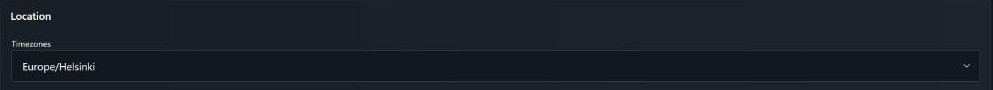
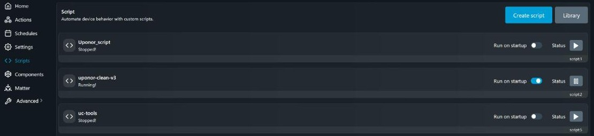
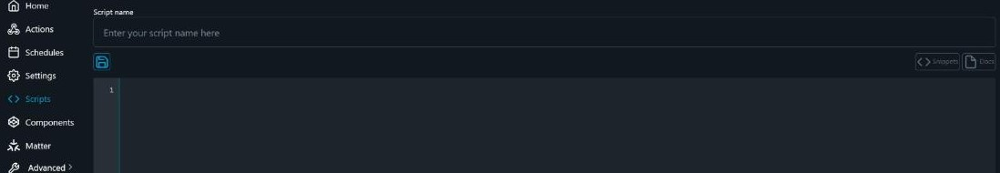
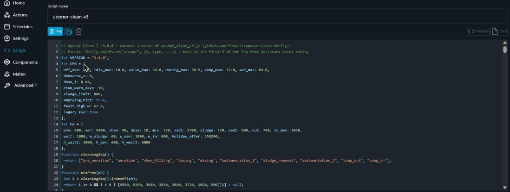
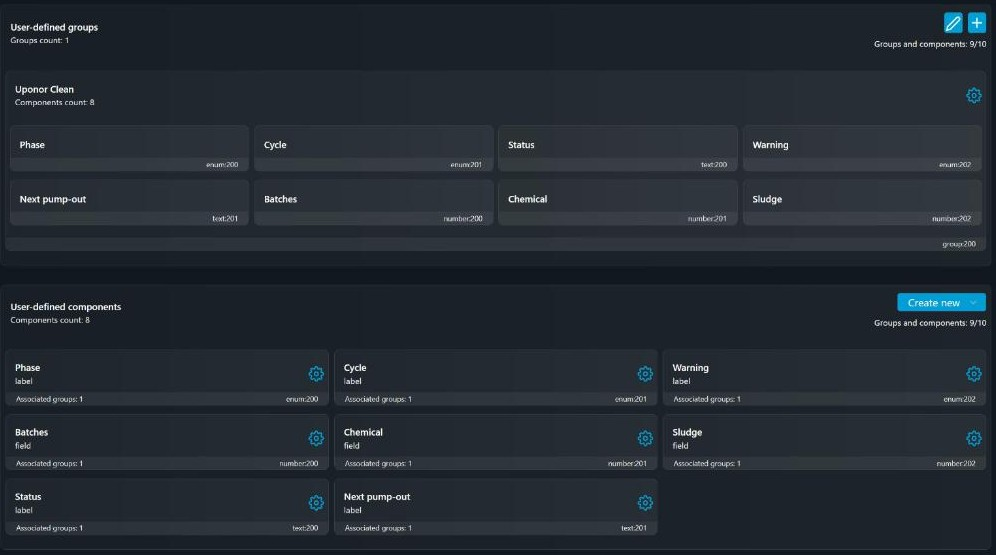
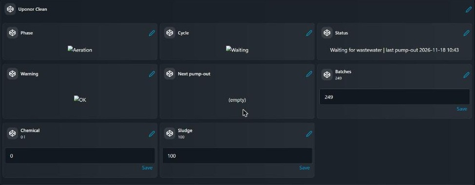
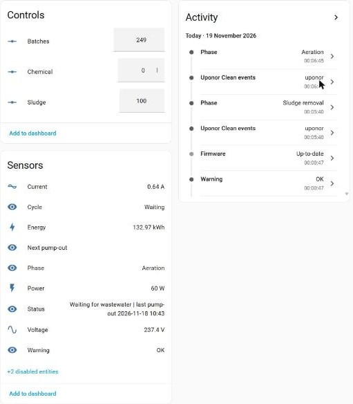
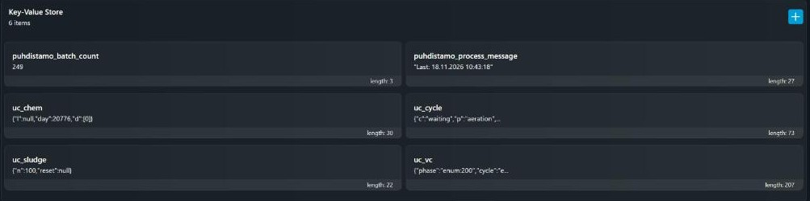

# Uponor Clean v3 – asennusohje (Shelly)

Skripti `shelly/v3/uponor_clean_v3_shelly.js` seuraa Uponor Clean I -puhdistamon ohjauskeskusta sähkönkulutuksen perusteella. Se tunnistaa jaksot (puhdistus, odotus, loma, testi) ja niiden vaiheet, laskee panokset, kemikaalin ja lietteen, arvioi seuraavan ulospumppauksen ja varoittaa poikkeamista. Skripti luo omat virtuaalikomponenttinsa, ja Shellyn käyttöliittymä näyttää ne. Home Assistantia ei tarvita, mutta sen Shelly-integraatio tuo komponentit entiteeteiksi ja Lovelace-kortti näyttää ne animoituna (`docs/kortti.md`).

Lähdekoodi on `shelly/v3/uponor_clean_v3.js`. Laitteelle ladataan sen tiivistetty versio `uponor_clean_v3_shelly.js`, josta kommentit on poistettu.

## 1. Edellytykset

- Shelly, jossa on em1- tai pm1-tehomittaus ja firmware 2.2.0 tai uudempi. Testattu laite on Shelly EM Mini Gen4 (firmware 2.2.0).
- Shelly mittaa puhdistamon syöttöä ja on samassa sähkönsyötössä. Skripti päättelee Shellyn käynnistyssyystä, oliko kyseessä sähkökatko (ohjauskeskus aloittaa uuden puhdistusjakson) vai Shellyn oma uudelleenkäynnistys (ohjauskeskus jatkaa).
- Laitteella on vapaana 9 virtuaalikomponenttipaikkaa (raja on 10). Skripti luo 8 komponenttia ja ryhmän.
- Muistia on vapaana vähintään noin 18 kt. Kaikilla skripteillä on yhteensä noin 25 kt. v3 käyttää noin 15 kt (huippu 18 kt), joten **v2.4 ja v3 eivät voi olla käynnissä yhtä aikaa**. Pysäytä muut skriptit.

## 2. Aikavyöhyke

Avaa Shellyn web-käyttöliittymä (`http://<shellyn-ip>/`) ja tarkista **Settings → Location and time → Timezones**. Kellonajat (seuraava ulospumppaus, viimeisin panos) lasketaan laitteen aikavyöhykkeellä. Ilman synkronoitua kelloa vaiheet ja panokset toimivat, mutta kellonajat puuttuvat.



## 3. Skriptin asennus

### Web-käyttöliittymästä

1. Avaa **Scripts** ja valitse **Create script**.

   

2. Anna nimeksi esimerkiksi `uponor-clean-v3`.

   

3. Avaa GitHubissa tiedosto `shelly/v3/uponor_clean_v3_shelly.js`, valitse **Raw**, kopioi koko sisältö (Ctrl+A, Ctrl+C) ja liitä se editoriin. Tiedosto on noin 40 000 merkkiä, ja editoriin mahtuu noin 50 000.
4. Tallenna (levykekuvake) ja käynnistä (**Start**). Konsoliin tulee rivi `version 3.0.0 started`.

   

5. Palaa **Scripts**-sivulle ja ota käyttöön **Run on startup**, jotta skripti käynnistyy sähkökatkon jälkeen.

### Komentoriviltä

Lataustyökalu kirjoittaa koodin paloina, vertaa sen laitteelta luettuun ja käynnistää skriptin. Luo ensin tyhjä skripti web-käyttöliittymässä ja katso sen numero (`script:2` listan oikeassa reunassa).

```
python3 shelly/tools/lataa_shellyyn.py <shellyn-ip> <skriptin-numero> shelly/v3/uponor_clean_v3_shelly.js --kaynnista
```

Jos laitteessa on salasana, lisää `--salasana SALASANA` (käyttäjätunnus on aina `admin`).

## 4. Ensimmäinen käynnistys

Skripti luo komponentit `Virtual.Add`-kutsulla muutamassa sekunnissa ja tallentaa niiden tunnukset KVS-avaimeen `uc_vc`. Ne näkyvät **Components**-sivulla ja etusivun ryhmässä **Uponor Clean**.



Komponentit eivät ole skriptin omistamia (`@meta`). Home Assistantin Shelly-integraatio ei näytä skriptin omistamia komponentteja, joten skripti luo tavalliset komponentit. Siksi ne myös säilyvät, jos skripti poistetaan.

Phase ja Cycle näyttävät aluksi `Unknown`, kunnes skripti tunnistaa ensimmäisen vaiheen. Odotusjaksossa se tapahtuu yleensä alle tunnissa, puhdistusjaksossa viimeistään seuraavassa vaihteessa. Jos Shelly käynnistyi sähkökatkon jälkeen, skripti tietää heti, että puhdistusjakso alkaa alusta.



Shellyn käyttöliittymä (firmware 2.2.0) näyttää lukutilassa olevan enum-komponentin arvon rikkinäisen kuvan kuvakkeen kanssa (esim. "Aeration" kuvakkeen vieressä). Se on käyttöliittymän ominaisuus, eikä se vaikuta arvoihin. Home Assistant näyttää arvot normaalisti.

## 5. Alkuarvot

Syötä arvot puhdistamon näytöltä Shellyn kenttiin (kirjoita ja **Save**), Home Assistantissa tai kortilla:

- **Batches**: panoslaskuri. v3 lukee aluksi v2.4:n KVS-avaimen `puhdistamo_batch_count`. Jos arvo eroaa puhdistamon näytöstä, syötä näytön lukema. Laskenta jatkuu siitä.
- **Chemical**: kemikaalin määrä astiassa litroina. 0 = ei asetettu (ei kemikaalivaroitusta). Syötä uusi määrä jokaisen täytön jälkeen. Skripti vähentää 0,04 l annostelua kohden.
- **Sludge**: panokset lietteen edellisestä tyhjennyksestä. Aseta 0, kun saostussäiliö on tyhjennetty. Muistutus tulee 800 panoksessa.

## 6. Home Assistant

1. **Settings → Devices & services → Shelly → laite → ⋮ → Reload**. Integraatio lukee komponentit vasta uudelleenlatauksessa tai Home Assistantin käynnistyksessä.
2. Laitteen sivulle tulevat ohjaimet Batches, Chemical ja Sludge sekä sensorit Phase, Cycle, Status, Warning ja Next pump-out.

   

   Entiteettien tunnukset muodostuvat laitteen nimestä ja alueesta, esim. `sensor.storage_room_uponor_clean_1_phase` ja `number.storage_room_uponor_clean_1_sludge`. Enum-sensorien tila on otsikko (`Aeration`, `Waiting`, `OK`).
3. **Tapahtumat**: integraatio luo skriptille tapahtumaentiteetin (nimeltään esim. `event.storage_room_uponor_clean_1_uponor_clean_v3`), joka on oletuksena pois käytöstä. Ota se käyttöön entiteetin asetuksista. Tässä asennuksessa se on nimetty `event.storage_room_uponor_clean_1_events`. Integraatio lukee tapahtumatyypit skriptin ensimmäisestä 5 kt:sta, joten tiedoston toinen rivi mainitsee `Shelly.emitEvent("uponor", …)`.

   Tapahtuman attribuuteissa ovat `type` ja tyypin tiedot:

   | `type` | Tiedot |
   | --- | --- |
   | `phase` | `cycle`, `phase`, `code`, `eta` |
   | `warning` | `key` (varoituksen avain), `on` (true/false) |
   | `batch` | `n`, `ts` (ja `user`, jos käyttäjä muutti laskuria) |
   | `chemical` | `l`, `days` |
   | `sludge` | `n`, `reset` |
   | `start` | `reason` (`power_cut` tai `restart`), `version` |

   Esimerkki: ilmoitus varoituksesta.

   ```yaml
   automation:
     - alias: Uponor Clean – varoitus
       triggers:
         - trigger: state
           entity_id: event.storage_room_uponor_clean_1_events
       conditions:
         - condition: template
           value_template: "{{ trigger.to_state.attributes.type == 'warning' and trigger.to_state.attributes.on }}"
       actions:
         - action: notify.notify
           data:
             title: Uponor Clean
             message: "{{ trigger.to_state.attributes.key }}: {{ states('sensor.storage_room_uponor_clean_1_warning') }}"
   ```

   Yksinkertaisempi vaihtoehto on laukaista ilmoitus Warning-sensorin tilan muutoksesta (`to` jokin muu kuin `OK`).
4. Kortti: ks. `docs/kortti.md`.

## 7. Tilakysely

`http://<shellyn-ip>/script/<numero>/state` palauttaa JSON-tilan, esim. (19.11.2026, odotusjakson ilmastus):

```json
{"version":"3.0.0","cycle":"waiting","phase":"aeration","code":"S204","since":1795039592,
 "eta":null,"last_pumpout":1794991398,"batches":249,"chemical":{"l":null,"days":null},
 "sludge":{"n":100,"reset":null},"warnings":[],"holiday_at":null,"holiday_since":null,
 "power":56.9,"band":"AER","time_synced":true,"uptime":15843}
```

Ajat ovat Unix-sekunteja. `eta` on seuraavan ulospumppauksen alku. `holiday_at` on hetki, jolloin odotusjakso siirtyy lomajaksoon, jos aloitustasoa ei saavuteta; se on tiedossa vasta, kun skripti on nähnyt odotusjakson alun. `band` on tehoalue (`OFF`, `IDLE`, `VALVE`, `DOSING`, `COMP`, `AER`).

## 8. Päivitys

1. Avaa skripti, pysäytä se (**Stop**), korvaa koodi uudella ja tallenna.
2. Käynnistä. Skripti jatkaa tallennetusta vaiheesta (KVS `uc_cycle`), ja laskurit säilyvät KVS:ssä. Komponentit säilyvät. Jos versionumero muuttui, skripti päivittää komponenttien asetukset.

Päivitä mieluiten odotusjakson aikana, ei ulospumppauksen aikana. Home Assistantissa kannattaa ladata integraatio uudelleen, jos komponentteja tuli lisää.

## 9. Siirtymä v2.4:stä

v2.4 käytti 10 käsin luotua komponenttia, joten ne poistetaan ennen v3:n asennusta. Asetukset on varmuuskopioitu `uc-tools`-skriptiin ja tiedostoon `shelly/v2/backup/v24_components_backup_2026-11-18.json`.

1. **Tarkista varmuuskopio.** `uc-tools`: `MODE = "show"`, käynnistä ja katso konsolista, että siinä on 10 komponenttia.
2. **Pysäytä v2.4** (`Uponor_script`) ja poista siltä *Run on startup*. Tee tämä odotusjakson aikana.
3. **Poista v2.4:n komponentit.** `uc-tools`: `MODE = "delete"`, tallenna ja käynnistä. Konsolissa pitää lukea `Done, 0 failed.`. Pysäytä `uc-tools`.
4. **Asenna v3** (kohdat 3–6). Batches tulee v2.4:n KVS-avaimesta ja viimeisin ulospumppaus sen viestistä.

v3 päivittää myös v2.4:n KVS-avaimet `puhdistamo_batch_count` ja `puhdistamo_process_message`, joten panosmäärä on ajan tasalla, jos v2.4 otetaan takaisin.

## 10. Poisto ja paluu v2.4:ään

1. Pysäytä v3 ja poista siltä *Run on startup* (tai poista skripti).
2. Poista v3:n komponentit: **Components** → komponentin hammasratas → **Delete** (8 komponenttia ja ryhmä Uponor Clean). Skriptin poisto ei poista niitä.
3. Poista KVS-avain `uc_vc` (**Advanced → KVS**). Muuten v3 yrittäisi myöhemmin käyttää samoja komponenttitunnuksia, vaikka niissä olisi nyt muita komponentteja. Muut `uc_*`-avaimet voi jättää, jos v3 halutaan myöhemmin takaisin samoilla laskureilla.
4. `uc-tools`: `MODE = "restore"`, tallenna ja käynnistä. Komponentit palautuvat samoilla tunnuksilla ja asetuksilla.
5. Käynnistä `Uponor_script` ja ota *Run on startup* käyttöön. Lataa Home Assistantissa Shelly-integraatio uudelleen.



## Komponentit

| Komponentti | Tyyppi | Sisältö |
| --- | --- | --- |
| Phase | enum, vain luku | `pre_aeration`, `aeration`, `chem_filling`, `dosing`, `mixing`, `sedimentation_1`, `sludge_removal`, `sedimentation_2`, `pump_out`, `pump_in`, `waiting`, `off`, `unknown` |
| Cycle | enum, vain luku | `cleaning`, `waiting`, `holiday`, `test`, `unknown` |
| Status | text, vain luku | Esim. "Pump-out at 14:35 (in 1 h 12 min)" tai "Waiting for wastewater \| last pump-out 2026-11-18 10:43", ja tärkein varoitus |
| Warning | enum, vain luku | Tärkein varoitus, ks. alla |
| Next pump-out | text, vain luku | Seuraavan ulospumppauksen alku paikallisena ISO-aikana, tyhjä kun ei tiedossa |
| Batches | number | Panoslaskuri, muokattavissa |
| Chemical | number (l) | Kemikaalia astiassa, vähenee 0,04 l annostelua kohden |
| Sludge | number | Panokset lietteen tyhjennyksestä, nollataan tyhjennyksessä |
| Uponor Clean | group | Edelliset samassa ryhmässä |

Varoitukset tärkeysjärjestyksessä:

| Avain | Otsikko | Milloin |
| --- | --- | --- |
| `no_power` | No power to plant | Puhdistamolla ei sähköä yli 1 min |
| `air_leak` | High power, check air hoses | Teho yli 62 W 2 min |
| `no_signal` | Power reading missing | Tehomittaus puuttuu |
| `compressor_idle` | Compressor not running | Kompressori ei ole käynyt 4 h |
| `outlet_blocked` | Outlet blocked? | Ulospumppauksen jälkeen alkoi heti uusi annostelu |
| `high_water` | High water | Ilmastus jäi pois tai katkesi |
| `paused` | Process paused? | Ohjauskeskus on ollut pysähdyksissä yli 5 min odotettua pidempään (esim. pysäytys paneelista) |
| `chemical_low` | Chemical low | Kemikaalia alle 10 päivän kulutus |
| `sludge_due` | Sludge emptying due | Lietelaskuri 800 |
| `sludge_emptied` | Sludge emptied? Set Sludge to 0 | Sisäänpumppauksen teho nousi kuin tyhjennyksen jälkeen |

## Asetukset

Asetuksia voi muuttaa KVS-avaimella `uc_cfg` (JSON), esim. `{"sludge_limit": 600, "chem_warn_days": 14}`. Muutos tulee voimaan skriptin uudelleenkäynnistyksessä.

| Asetus | Oletus | Merkitys |
| --- | --- | --- |
| `off_max`, `idle_max`, `valve_max`, `dosing_max`, `comp_max`, `aer_max` | 2, 10, 24, 38,5, 52, 64 | Tehoalueiden ylärajat (W, normalisoitu 230 V:iin) |
| `debounce_s` | 6 | Tätä lyhyemmät tasot ohitetaan |
| `dose_l` | 0,04 | Kemikaalia annostelua kohden (l) |
| `chem_warn_days` | 10 | Kemikaalivaroitus, kun jäljellä on alle näin monen päivän kulutus |
| `sludge_limit` | 800 | Lietemuistutuksen raja (puhdistamon oletus), 0 = pois |
| `emptying_hint` | true | Tyhjennysvihje sisäänpumppauksen tehosta |
| `fault_high_w` | 62 | Ilmavuotovaroituksen raja (W) |
| `legacy_kvs` | true | Päivitä myös v2.4:n KVS-avaimet |

## KVS-avaimet

| Avain | Sisältö |
| --- | --- |
| `uc_vc` | Komponenttien tunnukset roolin mukaan (`phase` → `enum:200` …), versio ja ryhmä |
| `uc_batch` | `{n, ts}`: panokset ja viimeisimmän ulospumppauksen aika (kirjoitetaan ensimmäisestä muutoksesta) |
| `uc_chem` | `{l, day, d}`: kemikaali, päivä ja 14 päivän annostelumäärät |
| `uc_sludge` | `{n, reset}`: lietelaskuri ja viimeisin nollaus |
| `uc_cycle` | Jakso, vaihe ja niiden alku (jatkaminen skriptin päivityksen jälkeen), odotusjakson alku (lomajakson ennuste) |
| `uc_base` | Sisäänpumppauksen perustaso tyhjennysvihjettä varten |
| `uc_cfg` | Käyttäjän asetukset (valinnainen) |

## Vianetsintä

| Oire | Syy ja korjaus |
| --- | --- |
| Konsolissa muistivirhe tai skripti pysähtyy | Toinen skripti on käynnissä. Pysäytä v2.4 ja `uc-tools`. |
| Komponentteja ei luoda | Vapaita paikkoja on alle 9. Poista ylimääräiset komponentit (**Components**) ja käynnistä skripti uudelleen. |
| Komponentti poistettiin vahingossa | Käynnistä skripti uudelleen. Se luo puuttuvan komponentin ja lisää sen ryhmään. |
| Home Assistant ei näytä entiteettejä | Lataa Shelly-integraatio uudelleen. |
| Phase on pitkään `Unknown` | Tehomittaus puuttuu tai puhdistamo on pysähtynyt. Katso tilakysely (`band`, `power`). |
| Kellonajat puuttuvat | Laitteen kello ei ole synkronoitu (`time_synced: false`). Tarkista verkkoyhteys ja NTP. |
