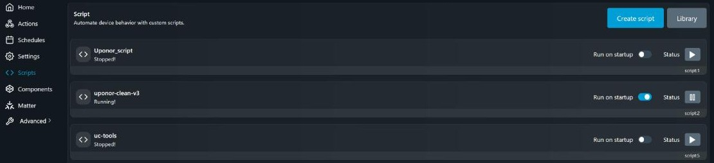
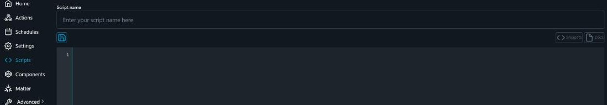
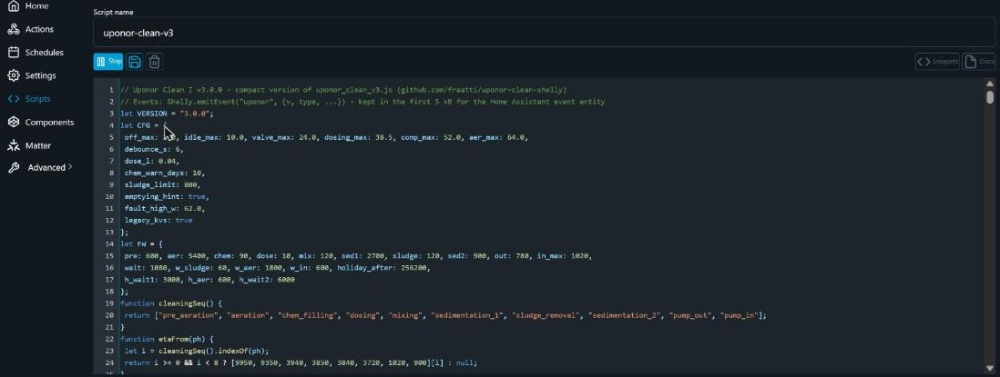
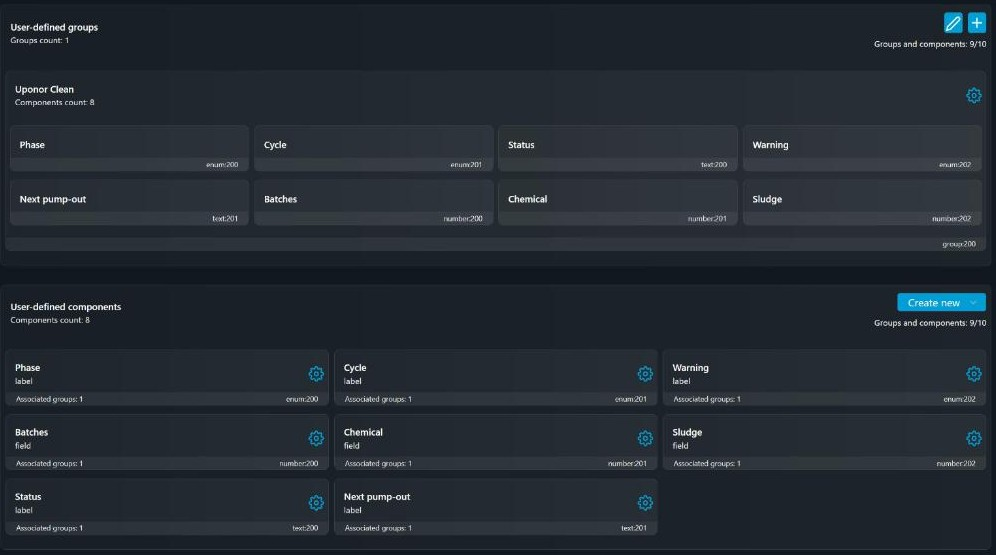
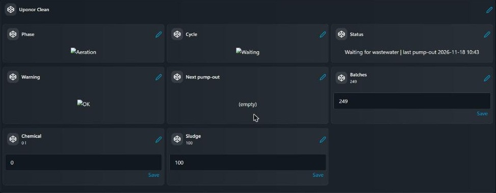
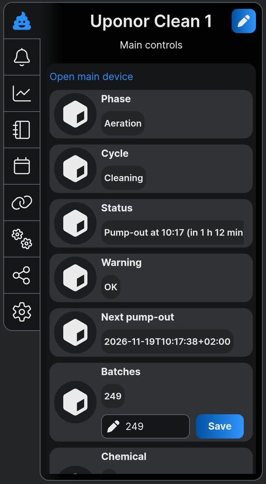
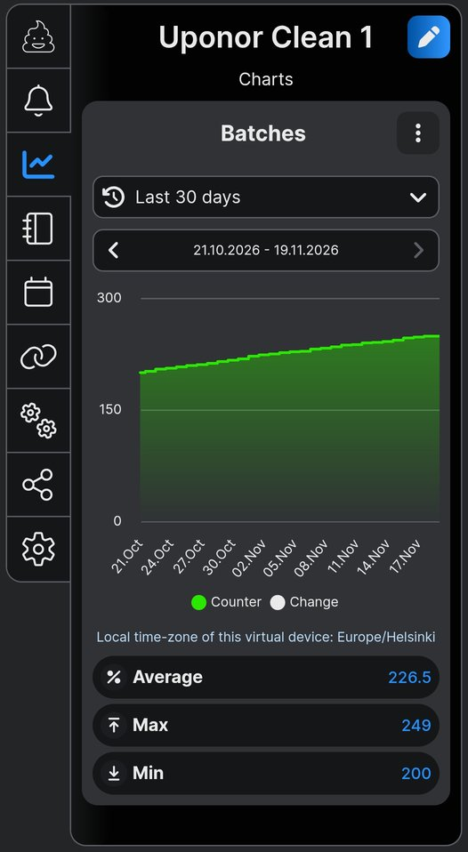
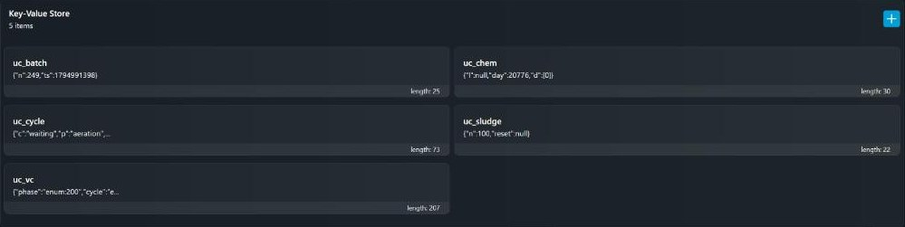

# Uponor Clean v3 – installation (Shelly)

**English** | [Suomi](v3-asennus.md)

The script `shelly/v3/uponor_clean_v3_shelly.js` follows the control unit of an Uponor Clean I wastewater treatment plant from its power consumption. It recognises the cycles (cleaning, waiting, holiday, test) and their phases, counts batches, chemical and sludge, estimates the next pump-out and warns about faults. The script creates its own virtual components, and the Shelly web UI and app show them. Home Assistant is not required. Using it with Home Assistant (entities, events, automations) is described in [`home-assistant.en.md`](home-assistant.en.md) and the card in [`ha-card/README.md`](../ha-card/README.md).

What the script does and does not do: [`features.md`](features.md).

The source code is `shelly/v3/uponor_clean_v3.js`. The device gets its compact version `uponor_clean_v3_shelly.js`, with the comments stripped.

## 1. Requirements

- A Shelly with an em1 or pm1 power meter and firmware 2.2.0 or newer. Tested on a Shelly EM Mini Gen4 (S4EM-001PXCEU16), firmware 2.2.0 (`20261109-150305/2.2.0-g7968dca`). The firmware version shows in the bottom bar of the Shelly web UI and in the device info in Home Assistant.
- The Shelly measures the plant's supply and sits on the same supply. From the Shelly's reset reason the script tells a power cut (the control unit starts a new cleaning cycle) from a restart of the Shelly alone (the control unit carries on).
- 9 free virtual component slots (the limit is 10). The script creates 8 components and a group.
- At least about 18 kB of free script memory. All scripts share about 25 kB. v3 uses about 15 kB (peak 19 kB), so other large scripts must be stopped.

## 2. Time zone

Open the Shelly web UI (`http://<shelly-ip>/`) and check **Settings → Location and time → Timezones**. Clock times (next pump-out, last batch) use the device time zone. Without a synchronised clock, phases and batches still work, but clock times are missing.


## 3. Installing the script

### In the web UI

1. Open **Scripts** and choose **Create script**.

   

2. Name it, for example, `uponor-clean-v3`.

   

3. On GitHub, open `shelly/v3/uponor_clean_v3_shelly.js`, choose **Raw**, copy everything (Ctrl+A, Ctrl+C) and paste it into the editor. The file is about 40,000 characters. The editor takes at most 50,000 characters and cuts a longer paste without any warning, so the source file `uponor_clean_v3.js` cannot be pasted into it.
4. Save (disk icon) and start (**Start**). The console shows `version 3.1.0 started`.

   

5. Go back to **Scripts** and turn on **Run on startup**, so the script starts again after a power cut.

### From the command line

The upload tool writes the code in chunks, compares it with what it reads back from the device and starts the script. First create an empty script in the web UI and note its number (`script:2` on the right of the list).

```
python3 shelly/tools/lataa_shellyyn.py <shelly-ip> <script-number> shelly/v3/uponor_clean_v3_shelly.js --kaynnista
```

`--kaynnista` starts the script after the upload. If the device has a password, add `--salasana PASSWORD` (the user name is always `admin`).

## 4. First start

The script creates the components with `Virtual.Add` within a few seconds and stores their ids in the KVS key `uc_vc`. They show on the **Components** page and in the **Uponor Clean** group on the home page.



The components are not owned by the script (`@meta`), because Home Assistant's Shelly integration does not show script-owned components. That is also why they stay if the script is deleted (section 9).

Phase and Cycle show `Unknown` until the script recognises the first phase. In a waiting cycle that usually takes less than an hour, in a cleaning cycle at most until the next phase change. If the Shelly started after a power cut, the script knows right away that a cleaning cycle starts from the beginning.



The same components show in the Shelly app (Shelly Smart Control) under the device. Batches has cloud statistics, so the app's *Charts* view plots the batch counter day by day. In the picture the chart continues from the v2.4 counter's history (200 → 249 since 21 Oct), because the component is the same `number:200`.

<p>


</p>

The Shelly web UI (firmware 2.2.0) shows the value of a read-only enum component next to a broken image icon (for example "Aeration"). This is a quirk of the web UI and does not affect the values. Home Assistant shows them normally.

## 5. Initial values

Enter the values from the plant's display into the Shelly fields (type and **Save**), in Home Assistant or on the card:

- **Batches**: the batch counter. Enter the reading on the plant's display. Counting continues from it.
- **Chemical**: chemical in the container, in litres. 0 = not set (no chemical warning). Enter the new amount after every refill. The script subtracts 0.04 l per dose.
- **Sludge**: batches since the sedimentation tank was last emptied. Set it to 0 after emptying. The reminder comes at 800 batches.

## 6. Home Assistant

Reload the Shelly integration in Home Assistant so the components become entities. Entities, the event entity and automation examples: [`home-assistant.en.md`](home-assistant.en.md).

## 7. State endpoint

`http://<shelly-ip>/script/<number>/state` returns the state as JSON, for example (19 Nov 2026, aeration in a waiting cycle):

```json
{"version":"3.0.2","cycle":"waiting","phase":"aeration","code":"S204","since":1795064382,
 "eta":null,"last_pumpout":1794991398,"batches":249,"chemical":{"l":null,"days":null},
 "sludge":{"n":100,"reset":null},"warnings":[],"holiday_at":null,"holiday_since":null,
 "power":56.8,"band":"AER","time_synced":true,"uptime":39545}
```

Times are Unix seconds. `eta` is the start of the next pump-out. `holiday_at` is when the waiting cycle turns into a holiday cycle if the start level is not reached; it is known only after the script has seen the waiting cycle start. `band` is the power band (`OFF`, `IDLE`, `VALVE`, `DOSING`, `COMP`, `AER`).

## 8. Updating

1. Open the script, stop it (**Stop**), replace the code and save.
2. Start it. The script continues from the stored phase (KVS `uc_cycle`), and the counters stay in KVS. The components stay. If the version number changed, the script updates the component settings.

Preferably update during a waiting cycle, not during a pump-out. If components were added, reload the Shelly integration in Home Assistant.

## 9. Removing

1. Stop the script and delete it (**Scripts**).
2. Delete the components: **Components** → the component's gear icon → **Delete** (8 components and the group Uponor Clean). Deleting the script does not delete them.
3. Delete the KVS keys `uc_*` (**Advanced → KVS**). If `uc_vc` is left, a new installation tries to use the same component ids.

## Components

| Component | Type | Contents |
| --- | --- | --- |
| Phase | enum, read-only | `pre_aeration`, `aeration`, `chem_filling`, `dosing`, `mixing`, `sedimentation_1`, `sludge_removal`, `sedimentation_2`, `pump_out`, `pump_in`, `waiting`, `off`, `unknown` |
| Cycle | enum, read-only | `cleaning`, `waiting`, `holiday`, `test`, `unknown` |
| Status | text, read-only | For example "Pump-out at 14:35 (in 1 h 12 min)" or "Waiting for wastewater \| last pump-out 2026-11-18 10:43", plus the most important warning |
| Warning | enum, read-only | The most important warning, see below |
| Next pump-out | text, read-only | Start of the next pump-out as local ISO time, empty when not known |
| Batches | number | Batch counter, editable. Cloud statistics `counter`: the Shelly app charts it day by day. |
| Chemical | number (l) | Chemical in the container, decreases by 0.04 l per dose |
| Sludge | number | Batches since the sludge was emptied, reset when emptied |
| Uponor Clean | group | All of the above in one group |

Warnings in order of importance:

| Key | Title | When |
| --- | --- | --- |
| `no_power` | No power to plant | No power to the plant for more than 1 min |
| `air_leak` | High power, check air hoses | Power above 62 W for 2 min |
| `no_signal` | Power reading missing | No power reading |
| `compressor_idle` | Compressor not running | The compressor has not run for 4 h |
| `outlet_blocked` | Outlet blocked? | A new dose started right after a pump-out. Ends when the level drops (a pump-in or the waiting cycle follows the pump-out). |
| `high_water` | High water | Aeration was skipped or cut short |
| `paused` | Process paused? | The control unit has been stopped more than 5 min longer than expected (e.g. stopped from the panel) |
| `chemical_low` | Chemical low | Chemical left for less than 10 days |
| `sludge_due` | Sludge emptying due | Sludge counter at 800 |
| `sludge_emptied` | Sludge emptied? Set Sludge to 0 | Pump-in power rose as it does after emptying |

## Settings

Settings can be changed with the KVS key `uc_cfg` (JSON), for example `{"sludge_limit": 600, "chem_warn_days": 14}`. A change takes effect when the script restarts.

| Setting | Default | Meaning |
| --- | --- | --- |
| `off_max`, `idle_max`, `valve_max`, `dosing_max`, `comp_max`, `aer_max` | 2, 10, 24, 38.5, 52, 64 | Upper limits of the power bands (W, normalised to 230 V) |
| `debounce_s` | 6 | Shorter levels are ignored |
| `dose_l` | 0.04 | Chemical per dose (l) |
| `chem_warn_days` | 10 | Chemical warning when less than this many days are left |
| `sludge_limit` | 800 | Sludge reminder limit (the plant's default), 0 = off |
| `emptying_hint` | true | Emptying hint from the pump-in power |
| `fault_high_w` | 62 | Air leak warning limit (W) |

## KVS keys



| Key | Contents |
| --- | --- |
| `uc_vc` | Component ids by role (`phase` → `enum:200` …), version and group |
| `uc_batch` | `{n, ts}`: batches and the time of the last pump-out (written on the first change) |
| `uc_chem` | `{l, day, d}`: chemical, day and doses for 14 days |
| `uc_sludge` | `{n, reset}`: sludge counter and last reset |
| `uc_cycle` | Cycle, phase and their start (to continue after a script update or a Shelly reboot), whether the dose of the dosing round is counted, start of the waiting cycle (holiday forecast) |
| `uc_warn` | Warnings that are on (they stay on over a restart) |
| `uc_base` | Pump-in baseline for the emptying hint |
| `uc_cfg` | User settings (optional) |

## Troubleshooting

| Symptom | Cause and fix |
| --- | --- |
| Memory error in the console or the script stops | Another script is running. Stop the other scripts. |
| Components are not created | Fewer than 9 free slots. Delete extra components (**Components**) and restart the script. |
| A component was deleted by mistake | Restart the script. It creates the missing component and adds it to the group. |
| Home Assistant shows no entities | Reload the Shelly integration ([`home-assistant.en.md`](home-assistant.en.md)). |
| Phase stays `Unknown` for a long time | The power reading is missing or the plant has stopped. Check the state endpoint (`band`, `power`). |
| Clock times are missing | The device clock is not synchronised (`time_synced: false`). Check the network connection and NTP. |
| Phases are recognised wrongly, no batches are counted or false warnings come | The plant's power levels may differ from this installation. Record the power (below) and send the recording. |

## Recording for troubleshooting

If the script does not work on another plant, the quickest way to find the cause is to record the power that the Shelly measures over 1–2 days. The recording shows the plant's power levels and phase lengths, and it can be run through the script in the test environment.

**First, the Shelly's own minute data.** The EM models (e.g. EM Mini Gen4) store one-minute averages themselves. Open `http://<shelly-ip>/em1data/0/data.csv` in a browser to get the past days' data at once. It shows whether the power levels are completely different, but valve pulses of a few seconds do not show.

**An exact recording on Windows: `shelly/tools/nauhuri.ps1`.** The recorder reads the power and voltage from the Shelly once a second and saves them to a CSV file. It needs no installation, as PowerShell comes with Windows.

1. Download the file: open `shelly/tools/nauhuri.ps1` on GitHub and choose **Download raw file**. Save it in the folder where you want the recording.
2. Right-click the file and choose **Run with PowerShell** (Windows 11: *Show more options* first). If Windows blocks it, open the file's **Properties** and tick **Unblock**. Alternatively, run `powershell -ExecutionPolicy Bypass -File .\nauhuri.ps1` in PowerShell.
3. Enter the Shelly's IP address. The Shelly app shows it (device → settings → device information), as does the router. If the device has a password, the recorder asks for it (the user name is always `admin`).
4. Enter the recording time in hours (default 48). The recorder keeps Windows from going to sleep. Keep a laptop plugged in with the lid open, and keep the computer on the same network as the Shelly. Press **Q** to stop earlier.
5. At the end the recorder packs the files into `uponor_YYYYMMDD_HHMM.zip` in the same folder. Send it to whoever is helping you.

| File | Contents |
| --- | --- |
| `uponor_….csv` | One row a second: time, power (W), voltage (V), current (A), power factor, frequency and, if the script is installed, its phase, cycle, power band and phase start. 48 hours is about 15 MB. |
| `uponor_…_minutes.csv` | The Shelly's own minute data for the last 7 days (EM models) |
| `uponor_…_info.json` | Device model and firmware, measuring channel, Wi-Fi signal strength, scripts, the script's state at the start and end and its KVS keys (`uc_*`) |
| `uponor_…_log.txt` | Connection breaks and Shelly restarts |

The files contain no MAC address, device id, IP address or Wi-Fi network name. The recorder works on Gen2 devices and newer with power metering (em1, pm1, switch or em).

Analysing a recording: `node test/v3_recording.js uponor_….csv` (see [`test/README.md`](../test/README.md)).
