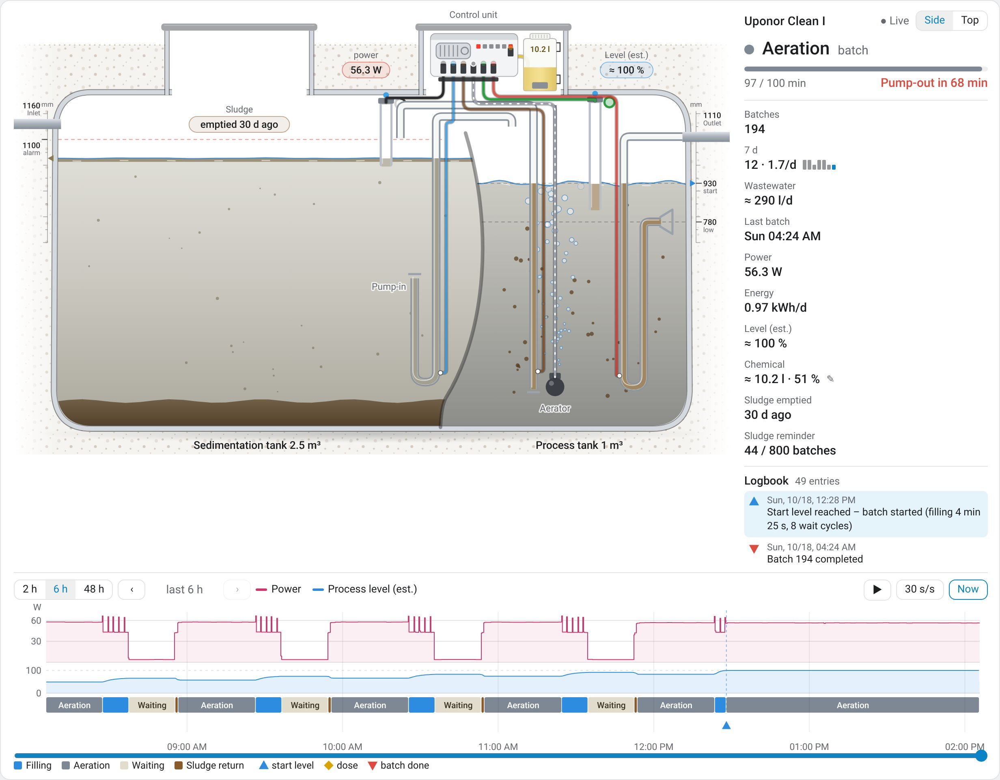
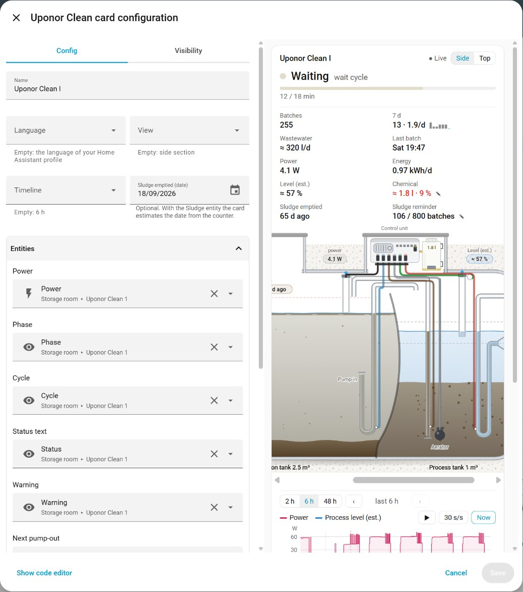
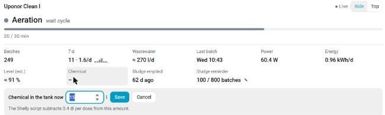
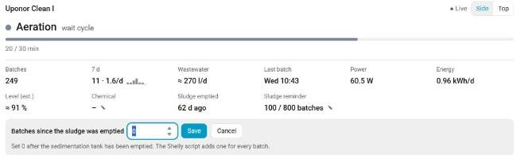
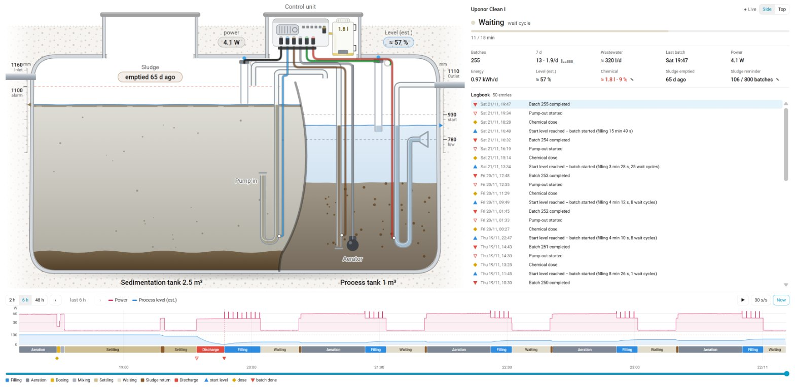

# Uponor Clean Card

**English** | [Suomi](../docs/kortti.md)

An animated Home Assistant card for the **Uponor Clean I** batch wastewater treatment plant. It draws the plant as a cross-section and as a top view of the process-tank riser, animates what the plant is doing, and adds a timeline with history playback and a logbook.



[Try the card in the demo](https://claude.ai/artifact/PnR5ZpnUjHt1qFZEd3TTut): it runs on recorded data in the browser.

The card does not talk to the plant. It reads the entities that the Shelly EM Mini Gen4 script publishes from the plant's power consumption. With **script v3** (`shelly/v3/`) these are Phase, Cycle, Status, Warning, Next pump-out, Batches, Chemical and Sludge; the card takes the phase, the pump-out time, the warnings and the chemical and sludge counters from the script. It also works with script v2.3 and v2.4 (cycle status, process message, normalized power and batch counter), and it can show the v2 history before the v3 entities start (`legacy`).

The Shelly script and its Home Assistant entities are described in [`docs/v3-install.md`](../docs/v3-install.md) and [`docs/home-assistant.en.md`](../docs/home-assistant.en.md).

Phase durations come from the control unit's firmware (board A settings, label VERSION 2.1.2): pre-aeration 10 min + aeration 90 min, chemical filling 90 s, dose 10 s, mixing 2 min, sedimentation I 45 min, sludge return 2 min, sedimentation II 15 min, pump-out 13 min, pump-in after pump-out up to 17 min, and the wait cycle (waiting 18 min, sludge return 1 min, aeration 30 min, pump-in 10 min). They match the recorded data to within seconds.

## Features

- **Side view** based on the manufacturer's cross-section (Clean I manual, p. 18): sedimentation tank (2.5 m³) and process tank (1 m³), curved partition wall that comes down almost vertically to the flat bottom, control unit with compressor and valves, chemical tank, pump-in, sludge-return and discharge modules, aerator, and the two pressure-switch sensor tubes.
- **Mammoth (airlift) pumps**: air is injected at the bottom of the riser, air slugs and water plugs rise up the pipe, and the water spills over in pulses. Flow weakens as the submergence drops during pump-out.
- **Aeration**: a bubble plume rises from the aerator, the mixed liquor circulates, and the surface moves. During settling the sludge flocs sink, a clear-water layer forms and the sludge blanket compacts.
- **Chemical dosing pump** (top view): the chamber fills through the check valve while the air line is vented, then compressed air pushes the dose up the outlet tube; the hole above the liquid breaks the siphon.
- **Pressure switches**: the green start-level tube and the black overflow tube show the trapped air column and a gauge that fills towards the trip point.
- **Pump-in mixing pulses**: during pump-in the aeration valve opens for 5 s every 125 s (the 61–67 W spikes in the power graph). The aerator puffs and the grey hose animates.
- **Liquids in the pipes**: sedimentation-tank water in the pump-in riser, sludge in the sludge-return riser, clear water in the discharge riser while pumping. At rest each riser and sensor tube holds the liquid around its intake, up to the surrounding level.
- **Valves follow the firmware outputs**: chemical filling opens the yellow and brown valves without the compressor; the dose runs the compressor with the yellow valve.
- **Top view** of the process-tank riser based on Uponor's module photo, with the same hose colours (1 red discharge, 2 grey aerator, 3 blue pump-in, 4 black overflow tube, 5 green start tube, 6 brown sludge return, yellow chemical). The hose that is carrying air animates.
- **Clean Control panel** in the top view: the panel lights follow the detected phase (Compressor, Dosing, Sludge removal, Pump out, Pump in, Aeration; Start when the process tank is at the start level; Chemical when the chemical estimate is below 10 %; Alarm when the Shelly script reports a warning), and the display shows the batch counter. The plant's own alarms are not visible to Home Assistant.
- **Timeline**: 2 h / 6 h / 48 h, power, estimated process-tank level, phase bar, event markers (start level reached, chemical dose, batch completed, warnings, holiday automation), playback from real time (1 s/s) to 5 min/s (default 30 s/s), and a scrubber.
- **Phases named as in the firmware**: Waiting (wait and holiday cycles) is shown separately from Settling (sedimentation I and II in a batch), also with script v2.3 data. Progress uses the firmware durations, including the 17-minute pump-in after pump-out and the 50/100-minute waits of the holiday cycle.
- **Logbook** derived from the history: batch started (with filling time and number of wait cycles, also when high water skips the aeration), chemical dose, pump-out, batch completed, holiday automation, plant restart after a power cut (a batch that starts from rest without pump-in), warnings, data gaps.
- **Warnings** from script v3 (no power, high power, no signal, compressor idle, outlet blocked, high water, paused, chemical low, sludge due, sludge emptied), v2.4 (high water, outlet blocked) and v2.3 (high power, no power, compressor not running) appear as a banner, in the logbook and on the timeline.
- **Chips**: batch counter, batches over the last 7 days with a per-day bar strip, wastewater per day (batches × 170 l), pump-out ETA or last batch, power, energy per day, process level, chemical left in litres, days since the sludge was emptied, and the sludge reminder count (800 batches).
- **Chemical amount**: click the Chemical value to enter how much is in the tank now. A full tank is 20 l (`chemical_capacity`), and a larger number is saved as 20 l. With script v3 the card writes it to the Shelly's Chemical number and the script subtracts 0.4 dl per dose; with v2 the card stores it in two helpers with the current batch counter. The level shows in the side view tank, on the top-view lid and in the chemical tank legend.
- **Sludge counter** (script v3): click the sludge reminder after the sedimentation tank was emptied and save 0. The date of emptying comes from the counter reset in the history, or from `sludge_emptied`; when that date no longer fits the counter, the card estimates it from the counter and the batch rate (shown with ≈).
- **Visual editor**: name, language, view, timeline, sludge date, entity pickers and plant settings. A card added from the card picker finds the v3 entities by itself.
- English and Finnish, chosen from the Home Assistant profile language or set per card (`language`). Follows the light or dark theme.
- Fits on one screen: on wide cards (980 px and wider) the drawing is on the left with the timeline under it, and the status, chips and logbook are on the right. The drawing's height follows the browser window, so the whole card stays visible without scrolling on a laptop or desktop screen (tested from 1024 × 700 to 2400 × 1140). A page can reserve room under the card with the CSS variable `--uc-fit-bottom` (default 14 px).

## Installation

1. Copy `uponor-clean-card.js` to `/config/www/`.
2. In Home Assistant: **Settings → Dashboards → ⋮ → Resources → Add resource**
   - URL: `/local/uponor-clean-card.js?v=1.8.3`
   - Resource type: **JavaScript module**
   Change the `?v=` number whenever you replace the file, so browsers load the new version.
3. Add the card to a dashboard. It is designed for full width: use a **Panel** view, or a **Sections** view where the card spans the full width.

With script v3:

```yaml
type: custom:uponor-clean-card
name: Uponor Clean I
entities:
  power: sensor.uponor_clean_1_power
  phase: sensor.storage_room_uponor_clean_1_phase
  cycle: sensor.storage_room_uponor_clean_1_cycle
  message: sensor.storage_room_uponor_clean_1_status
  warning: sensor.storage_room_uponor_clean_1_warning
  next_pumpout: sensor.storage_room_uponor_clean_1_next_pump_out
  batch_counter: number.storage_room_uponor_clean_1_batches
  chemical: number.storage_room_uponor_clean_1_chemical
  sludge: number.storage_room_uponor_clean_1_sludge
  energy: sensor.uponor_clean_1_energy
sludge_emptied: "2026-09-18"
legacy:                        # optional: v2 history before the v3 entities start
  status: select.uponor_clean_1_vc_cycle_status
  message: text.storage_room_uponor_clean_1_process_message
  batch_counter: sensor.uponor_clean_1_vc_batch_counter
```

With script v2.3 or v2.4:

```yaml
type: custom:uponor-clean-card
name: Uponor Clean I
entities:
  power: sensor.uponor_clean_1_vc_normalized_consumption
  status: select.uponor_clean_1_vc_cycle_status
  message: text.storage_room_uponor_clean_1_process_message
  batch_counter: sensor.uponor_clean_1_vc_batch_counter
  energy: sensor.uponor_clean_1_energy
sludge_emptied: "2026-09-18"
chemical_amount: input_number.uponor_chemical_amount
chemical_refill_counter: input_number.uponor_chemical_refill_counter
```

## Options

| Option | Default | Description |
|---|---|---|
| `name` | `Uponor Clean I` | Card title |
| `entities.power` | `sensor.uponor_clean_1_vc_normalized_consumption` | Normalized power (W) |
| `entities.status` | `select.uponor_clean_1_vc_cycle_status` | Cycle status (Filling, Aeration, Dosing, Settling, Sludge, Discharge, Unknown). Finnish titles also work. |
| `entities.message` | `text.storage_room_uponor_clean_1_process_message` | Process message (ETA, Discharge, Holiday automation, Warning, Last) |
| `entities.batch_counter` | `sensor.uponor_clean_1_vc_batch_counter` | Batch counter |
| `entities.energy` | none | Optional energy sensor (kWh, total) for the kWh/day chip |
| `entities.phase` | none | Script v3: Phase sensor. When set, it replaces `status`. |
| `entities.cycle` | none | Script v3: Cycle sensor (cleaning, waiting, holiday, test) |
| `entities.warning` | none | Script v3: Warning sensor |
| `entities.next_pumpout` | none | Script v3: Next pump-out (local ISO time) |
| `entities.chemical` | none | Script v3: Chemical number (litres). Replaces `chemical_amount` and `chemical_refill_counter`. |
| `entities.sludge` | none | Script v3: Sludge number (batches since emptying). Replaces `sludge_reset_counter`. |
| `legacy` | none | Older entities (`status`, `message`, `batch_counter`) whose history is shown before the first value of the current ones |
| `hours` | `6` | Initial timeline range: 2, 6 or 48 |
| `view` | `side` | Initial view: `side` or `top` |
| `language` | `auto` | `auto`, `en` or `fi` |
| `batch_volume` | `170` | Litres per batch, used for the wastewater estimate |
| `sludge_return_lpm` | `12` | Estimated sludge-return flow (l/min). Lowers the process-tank level during sludge return (2 min in a batch ≈ 25 l, 1 min in a wait cycle). |
| `history_days` | `8` | Days of status history loaded for the model and the 7-day statistics |
| `sludge_emptied` | none | Date the sedimentation tank was emptied (`YYYY-MM-DD`); shows days since emptying and grows the sludge layer in the drawing. With `entities.sludge` it is optional: a reset in the history wins, and a date that no longer fits the counter is replaced by an estimate. |
| `sludge_reset_counter` | none | Batch counter value when the plant's sludge reminder was reset (Test button 10–15 s), as a number or an entity. Shows batches towards the reminder and lights the panel's Alarm light when it is due. |
| `sludge_reminder_batches` | `800` | Batches until the plant's sludge reminder (E051) |
| `chemical_amount` | none | Litres in the chemical tank at `chemical_refill_counter`, as an `input_number` entity (recommended) or a number |
| `chemical_refill_counter` | none | Batch counter value when the amount was set, as an `input_number` entity (recommended) or a number. Enables the chemical estimate. |
| `chemical_capacity` | `20` | Tank capacity in litres: a full tank for the percentage and the largest amount that can be entered |
| `chemical_dose_dl` | `0.4` | Dose per batch (the manual: about 0.4 dl) |
| `chemical_fill_liters` | `15` | Amount used when `chemical_amount` is not set |

### Chemical amount with helpers (script v2)

With script v3 use `entities.chemical`; no helpers are needed. For v2, create two helpers (Settings → Devices & services → Helpers → Number, or YAML):

```yaml
input_number:
  uponor_chemical_amount:
    name: Uponor chemical in tank
    min: 0
    max: 20
    step: 0.1
    unit_of_measurement: l
    mode: box
  uponor_chemical_refill_counter:
    name: Uponor chemical – batch counter at setting
    min: 0
    max: 99999
    step: 1
    mode: box
```

Add `chemical_amount: input_number.uponor_chemical_amount` and `chemical_refill_counter: input_number.uponor_chemical_refill_counter` to the card. After a refill, click the Chemical value on the card, enter the litres now in the tank and press Save. The card writes the amount and the current batch counter to the helpers, and from then on subtracts 0.4 dl for every batch. Any Home Assistant user who can change the helpers can do this.

## How the levels are estimated

The plant has no level sensor that Home Assistant can read, so the water levels in the drawing are estimates. They are marked as estimates on the card.

- After pump-out the process tank is at the pump-out level (the discharge intake funnel). The start level is 170 l higher; the green tube's pressure switch trips there, and the plant goes straight from filling to aeration. That transition is the fixed point of the model.
- Between those two points the level only rises during fillings. Each filling moves the wastewater that came in since the previous filling, so its share of the 170 l is proportional to the time since the previous filling. For a cycle that has not reached the start level yet, the card uses the typical cycle length from the last days and stops just below the start level until the switch trips.
- A sludge return pumps sludge water from the process tank to the sedimentation tank, so the process-tank level drops (by default 12 l/min) and the sedimentation tank rises. The next filling brings that water back.
- During pump-out the level falls quickly at first and slower towards the end, as an airlift pump loses flow when its submergence drops.
- If pump-out is followed directly by a new chemical filling (outlet blocked), the level stays up, as the start-level switch did not release. If high water skips the aeration, the pump-in before the chemical filling still counts as reaching the start level.
- The sedimentation tank level rises slowly between fillings and drops during each filling. Its swing is exaggerated so that it is visible.
- Geometry (heights in mm) is approximate and based on the manual: inlet 1160 mm, outlet 1110 mm, partition top about 1125 mm, start level about 930 mm, pump-out level about 780 mm, alarm level about 1100 mm.
- The start and alarm sensors are 10 mbar pressure switches. A switch trips when the water is about 10 cm above the open end of its tube (10 mbar ≈ 102 mm of water, plus a little as the trapped air compresses). The tube ends are therefore drawn about 105 mm below the trip levels: the green tube at about 825 mm and the black tube at about 995 mm. The green tube end is above the pump-out level, so the air column resets after every pump-out.

## Screenshots from Home Assistant

The visual editor (**Edit** on the dashboard):



Entering the chemical amount and resetting the sludge counter on the card:





The card on the real installation:



## Troubleshooting

| Symptom | Fix |
| --- | --- |
| The card does not show, *Custom element doesn't exist* | Check the resource URL and type (JavaScript module) and reload the page. |
| An old version shows after an update | Change the resource's `?v=` number and clear the browser cache. |
| *Waiting for history…* stays on | The recorder is off or the entities are wrong. Check the entities in the card options. |
| The phase is *Unknown* | The Shelly script has not recognised the phase yet, or the power reading is missing. See [`docs/v3-install.md`](../docs/v3-install.md). |
| *Data gap (Shelly or Home Assistant)* in the logbook | Home Assistant or the Shelly did not record readings for 10 seconds or more (e.g. a power or network outage, a Home Assistant update). Shorter breaks, such as the Shelly integration reloading when the Shelly's settings change, are not shown: the card uses the last known value for them. |

## Requirements

- Home Assistant with the recorder (the card uses the `history/history_during_period` WebSocket API). The visual editor uses `getConfigForm` (tested on Home Assistant 2026.10); versions without it show the YAML editor.
- The Shelly script v3 (recommended) or v2.3/v2.4 with the virtual components above. With v2.4, add the option `W` (title `Waiting`) to the Cycle Status enum to get the Waiting status from the script; without it the card still separates waiting from settling by context.
- A current desktop or mobile browser. On narrow screens the drawing scrolls sideways.

## Licence

MIT
